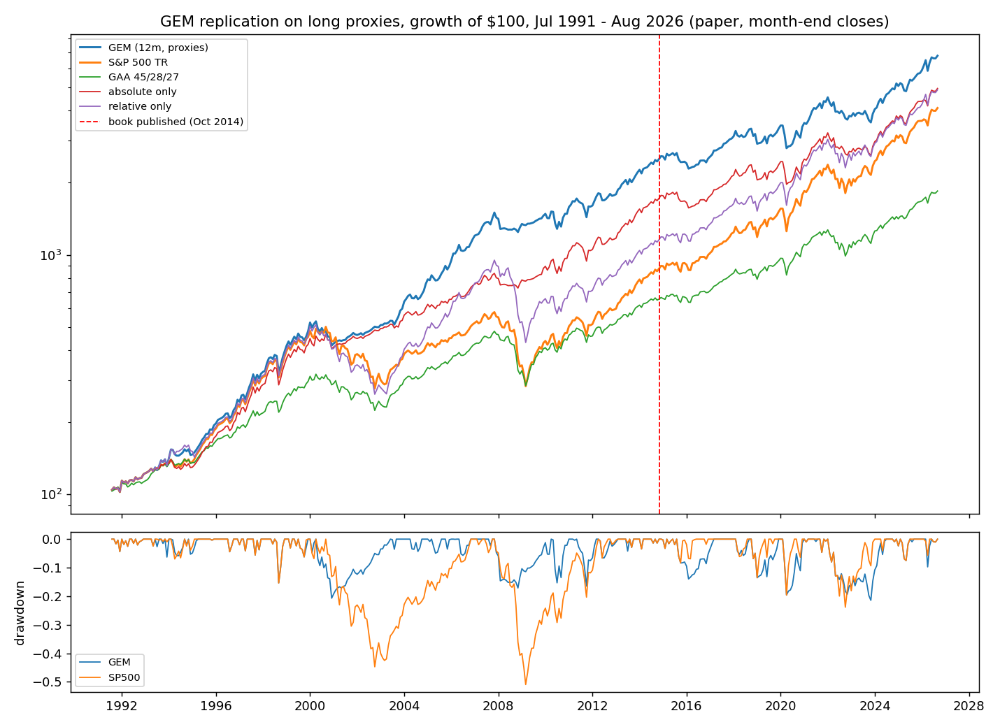
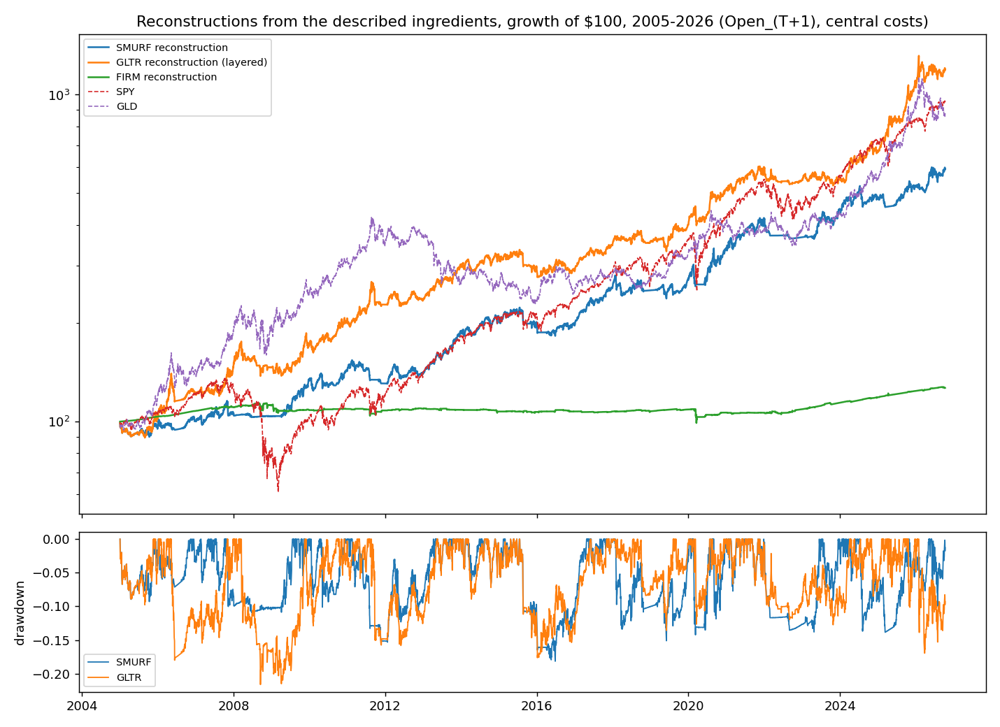

<!-- GENERATED FILE. EDIT THE CANONICAL KNOWLEDGE RECORD. -->

# Antonacci (Concretum interview 2026-10): GEM replication and public-ingredient reconstructions of SMURF / GLTR / BADASS / FIRM / Snap Back

!!! warning "Research-only"
    This page summarizes saved research evidence. It does not authorize LIVE, allocation, or deployment.

## TL;DR

> **Verdict:** GEM reproduces on proxies (1991-2026 CAGR 12.7%, excess Sharpe 0.82, MDD -21.4%); post-publication 2014-11..2026-08 it trails the S&P 500 (Sharpe 0.56 vs 0.82, bootstrap P(GEM>SP)=0.02). The proprietary claims (SMURF Sharpe 1.52, GLTR 2.03, BADASS 2.01) are not reachable with the described public ingredients: best grid cells 0.67 / 0.90 / 0.88; primaries 0.62 / 0.77. 50/30/20 of the primaries: Sharpe 0.81 vs site 2.35. Snap Back primary win rate 51.2% vs claimed 70-80%.

> **Status:** `diagnostic`

> **Disposition:** `rejected`

> **Replication:** `gem_reproduced_with_proxies; proprietary_models_not_reproducible_from_public_ingredients`

## Research question

Replicate the public GEM rule on long proxies and ETFs (including the post-publication period the interview figure glosses over), and measure what the described ingredients of the four proprietary models (Donchian ensembles, mean-reversion exits, GLD/IAU confirmation, layering, fixed-income reversal overlay, Snap Back) can deliver against the published 2005-2026 statistics.

## Exact setup

| Field | Value |
| --- | --- |
| Signal family | cross_asset_dual_momentum_and_channel_breakout_with_reversal_overlays |
| Universe | ["US / ACWI ex-US proxies / bonds (GEM)", "IVV ACWX AGG BIL (GEM ETF)", "SPY QQQ IWF VUG (SMURF)", "GLD IAU (GLTR)", "BLOK BKCH BITQ DAPP + GBTC->IBIT, ETHE->ETHA (BADASS)", "11 fixed-income ETFs (FIRM)", "~85 ETFs + 20 mega-caps (Snap Back)"] |
| Decision | GEM: month-end close; reconstructions: every Close_T |
| Fill | Open_(T+1) primary; Close_(T+1) and paper Close_T as robustness |
| Primary cost layer | central_research |
| Last reviewed | 2026-10-10T00:00:00+03:00 |

## Timing and overnight attribution

```text
information available: GEM: month-end close; reconstructions: every Close_T
primary executable fill: Open_(T+1) primary; Close_(T+1) and paper Close_T as robustness
```

If final `Close_T` data formed the signal, a hypothetical `Close_T` entry is diagnostic only unless a separate pre-close protocol was modeled. Comparing that diagnostic with `Open_(T+1)` and applying the compounded return identity shows whether the apparent edge occurred in the overnight gap. Missing attribution numbers mean **not tested**, not zero.

| Attribution field | Value |
| --- | --- |
| Status | tested |
| Diagnostic Path | paper month-end fills (published convention) / paper Close_T |
| Executable Path | stateful daily engine, Open_(T+1), 5 bps one-way (15 bps crypto/blockchain) |
| Method | frozen spec v1; GEM family HG1-HG3 and reconstruction family HR1-HR6, paired block bootstrap with Holm |
| Headline Result | HG2 (post-publication GEM >= SP500) P=0.02; HR2 (GLTR rec > GLD) P=0.88; HR6 (50/30/20 > 60/40) P=0.69 |
| Metrics | {"HG2_p_a_gt_b": 0.0194, "HR2_p_a_gt_b": 0.8776, "HR6_p_a_gt_b": 0.6896} |
| Unavailable Reason | N/A |
| Artifact | pakal-research/reports/antonacci_models_study/tables/rec_bootstrap.csv |

## Primary metrics

| Metric | Value |
| --- | ---: |
| Period | 2005-01-03..2026-06-30 (site window) |
| Universe | 50/30/20 SMURF/GLTR/FIRM reconstructions, monthly rebalanced |
| Cost Layer | central_research (5 bps one-way) |
| Cagr | 8.43% |
| Annualized Volatility | 8.35% |
| Sharpe | 0.812 |
| Maximum Drawdown | -12.04% |
| Turnover | N/A |

## Four separate verdicts

| Question | Conclusion |
| --- | --- |
| Source Replication | GEM: reproduced on proxies (pre-2014 Sharpe 0.97 vs site 0.96 for 1950-2017); proprietary models: not reproducible, reachability tested |
| Predictive Value | GEM post-publication: no edge over the S&P 500; channel-breakout reconstructions: defensive, below buy-and-hold Sharpe in the 2016-2026 half for equities |
| Economic Value | nothing promotable; the GLTR-style gold trend with layering is the only reconstruction above its buy-and-hold on Sharpe |
| Promotion | none |

## Key findings

| Feature | Role | Direction | Status | Effect | Action |
| --- | --- | --- | --- | --- | --- |
| GEM 12-month dual momentum (public rule) | N/A | N/A | N/A | N/A | N/A |
| Donchian 63/126/252 ensemble + stretch exit on SPY/QQQ (SMURF reconstruction) | N/A | N/A | N/A | N/A | N/A |
| Gold channel trend with GLD/IAU confirmation and layering into the stock model (GLTR reconstruction) | N/A | N/A | N/A | N/A | N/A |
| Snap Back style 3-day sell-off reversal, 2-session hold | N/A | N/A | N/A | N/A | N/A |
| Hill-climb adjusted-Sharpe weights vs equal weights | N/A | N/A | N/A | N/A | N/A |

## Visual evidence






## Limitations

- proprietary rules undisclosed; Part B is a reachability study, not a replication
- GEM international proxy from 1990 only; bond leg spliced; French US market before 1988
- mega-cap and ETF lists are 2026 survivors
- site figures gross and month-end; BADASS window 8.7 years, one crypto cycle

## Next gates

- none recommended; GEM-type TAA is already covered by the book's TAA sleeves

## Sources

- `Concretum Research, Gary Antonacci: From Dual Momentum to Advanced Models, Substack 2026-10-10`
- `optimalmomentum.com proprietary-models-2, extended-backtest, FAQ, global-equities-momentum (2026-10-10)`
- `Antonacci, Dual Momentum Investing (2014)`
- `pakal-research/reports/trend_breakout_momentum_candidates_study (TBMC-01 Dow Award replication)`
- `pakal-research/reports/concretum_etf_trend_study (CET-01 Donchian ensemble)`

## Canonical artifacts

| Artifact | Pakal path |
| --- | --- |
| Concise Report | `pakal-research/reports/antonacci_models_study/REPORT.md` |
| Full Report | `pakal-research/reports/antonacci_models_study/REPORT_FULL.md` |
| Notebook | `pakal-research/reports/antonacci_models_study/antonacci_models_study.ipynb` |
| Frozen Specification | `pakal-research/reports/antonacci_models_study/research_spec_frozen.json` |
| Manifest | `pakal-research/reports/antonacci_models_study/run_manifest.json` |
| Primary Source Code | `["pakal-research/antonacci_models_study/ams_data.py", "pakal-research/antonacci_models_study/ams_lib.py", "pakal-research/antonacci_models_study/ams_gem.py", "pakal-research/antonacci_models_study/ams_models.py", "pakal-research/antonacci_models_study/ams_charts.py", "pakal-research/antonacci_models_study/test_ams_timing.py", "pakal-research/antonacci_models_study/ams_build_artifacts.py"]` |
| Primary Tables | `["pakal-research/reports/antonacci_models_study/tables/gem_long_metrics.csv", "pakal-research/reports/antonacci_models_study/tables/gem_bootstrap.csv", "pakal-research/reports/antonacci_models_study/tables/gem_etf.csv", "pakal-research/reports/antonacci_models_study/tables/rec_reachability.csv", "pakal-research/reports/antonacci_models_study/tables/rec_primaries.csv", "pakal-research/reports/antonacci_models_study/tables/rec_grid.csv", "pakal-research/reports/antonacci_models_study/tables/rec_bootstrap.csv", "pakal-research/reports/antonacci_models_study/tables/rec_portfolios.csv", "pakal-research/reports/antonacci_models_study/tables/rec_snapback.csv"]` |
| Primary Charts | `["pakal-research/reports/antonacci_models_study/charts/gem_equity_drawdown.png", "pakal-research/reports/antonacci_models_study/charts/gem_relative_to_sp500.png", "pakal-research/reports/antonacci_models_study/charts/rec_equity_drawdown.png", "pakal-research/reports/antonacci_models_study/charts/rec_grid_vs_claims.png", "pakal-research/reports/antonacci_models_study/charts/rec_badass.png", "pakal-research/reports/antonacci_models_study/charts/rec_portfolios.png", "pakal-research/reports/antonacci_models_study/charts/rec_snapback.png"]` |
