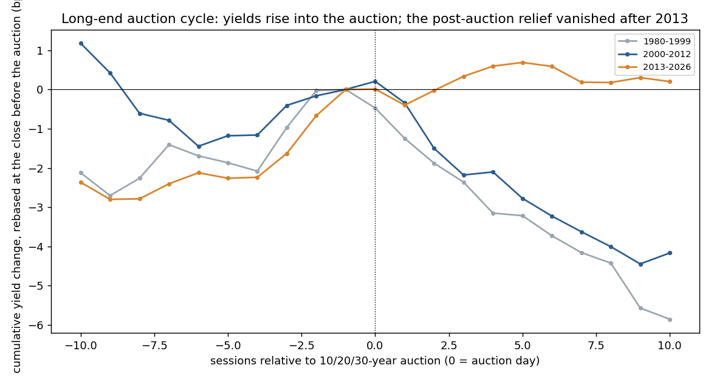
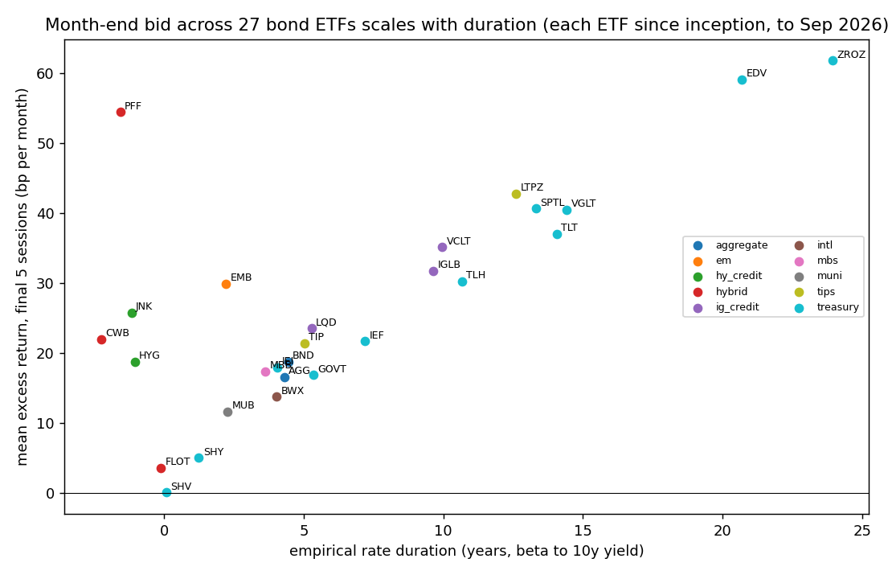

<!-- GENERATED FILE. EDIT THE CANONICAL KNOWLEDGE RECORD. -->

# Bond calendar flow family: Valuelytica ZROZ month-end effect and every comparable bond calendar effect (27 ETFs, 1962-2026 yields, auctions, FOMC, NFP, coupons)

!!! warning "Research-only"
    This page summarizes saved research evidence. It does not authorize LIVE, allocation, or deployment.

## TL;DR

> **Verdict:** Source replicated (ZROZ EOM 9.9%/0.81 vs claim 9.46%/0.81; EOMS 16.2%/0.91 vs 17.3%/1.01; central cost 0.63/0.66). Month-end bond bid is real and index-driven: absent in 1962-84 yields, present in every era since 1985, larger in refunding months, scales with duration across 27 ETFs (corr 0.95). ZROZ is not a better vehicle (same edge per duration; IEI/IEF/TLT higher Sharpe, far more liquid). Frozen composite gate passed no window. FOMC window, pre-auction long-end short (post-2013 regime) and refunding-month EOM are forward hypotheses for shadow logging; NFP premium, post-auction relief, mid-month coupon and quarter-end amplification rejected. 2026 YTD EOM on ZROZ -8%.

> **Status:** `forward_hypothesis`

> **Disposition:** `shadow`

> **Replication:** `replicated`

## Research question

Reproduce Valuelytica's ZROZ end-of-month claim, test the same month-end bid across 27 bond ETFs and 64 years of Treasury yields, and put every comparable bond calendar/flow effect (BOM reversal, auction cycle, FOMC, employment report, mid-month coupon, quarter/year-end) on one bench with a frozen composite gate.

## Exact setup

| Field | Value |
| --- | --- |
| Signal family | calendar_bond_index_flow |
| Universe | ["27 US bond ETFs (Treasury, TIPS, IG, HY, MBS, muni, EM, intl, aggregate, hybrid)", "FRED H.15 CMT yields 1962-2026", "US Treasury coupon auctions 1979-2026", "scheduled FOMC 1998-2026"] |
| Decision | Calendar known in advance; auction windows no earlier than announcement close; FOMC scheduled dates; NFP rule-based proxy |
| Fill | MOC at the close before each window, exit at window-end close (close-to-close) |
| Primary cost layer | central_research |
| Last reviewed | 2026-10-16T12:00:00+03:00 |

## Timing and overnight attribution

```text
information available: Calendar known in advance; auction windows no earlier than announcement close; FOMC scheduled dates; NFP rule-based proxy
primary executable fill: MOC at the close before each window, exit at window-end close (close-to-close)
```

If final `Close_T` data formed the signal, a hypothetical `Close_T` entry is diagnostic only unless a separate pre-close protocol was modeled. Comparing that diagnostic with `Open_(T+1)` and applying the compounded return identity shows whether the apparent edge occurred in the overnight gap. Missing attribution numbers mean **not tested**, not zero.

| Attribution field | Value |
| --- | --- |
| Status | not_applicable |
| Diagnostic Path | paper close-to-close |
| Executable Path | MOC close-to-close with central/conservative costs |
| Method | calendar windows contain no price signal; costs layered |
| Headline Result | TLT EOM 0.87 paper / 0.76 central / 0.66 conservative (2010-2025) |
| Metrics | {"tlt_eom_central_2010_2025": 0.763, "tlt_eom_paper_2010_2025": 0.87, "zroz_eom_central_2010_2025": 0.627} |

## Primary metrics

| Metric | Value |
| --- | ---: |
| Period | 2003-01-01 to 2026-09-30 |
| Universe | TLT |
| Cost Layer | central_research (3 bps/side) |
| Cagr | 5.50% |
| Annualized Volatility | N/A |
| Sharpe | 0.587 |
| Maximum Drawdown | -17.20% |
| Turnover | 2400.00% |

## Four separate verdicts

| Question | Conclusion |
| --- | --- |
| Source Replication | replicated (paper close-to-close, final-5 / first-5 mapping) |
| Predictive Value | EOM confirmed (t 3.9 TLT, 25/27 ETFs q<0.10, 1985+ yields); FOMC and pre-auction directional; NFP, mid-month, post-auction (2013+) rejected |
| Economic Value | EOM TLT Sharpe 0.59 central 2003-2026; ZROZ 0.54; thin vs costs on short-duration ETFs |
| Promotion | none; C_main paper trial unchanged; three shadow lines |

## Key findings

| Feature | Role | Direction | Status | Effect | Action |
| --- | --- | --- | --- | --- | --- |
| EOM final-5 long bond (index extension bid) | signal | positive | research_candidate | TLT +37 bp/month gross (t 3.9); 2.6-4.5 bp per duration-year; 10y yield -2.1 to -2.6 bp per month-end since 1985 | already inside C_main; prefer IEF/IEI/TLT over ZROZ |
| EOM conditioned on refunding months (Feb/May/Aug/Nov) | filter | positive | forward_hypothesis | TLT +71 vs +20 bp per month-end (p 0.011); Sharpe 0.56/0.67/1.22, 2026 +2.0; non-refunding 2023-26 negative | shadow-log beside C_main EOM leg |
| FOMC window long TLT (sessions -1..+1) | signal | positive | forward_hypothesis | +31 bp per meeting (t 2.4); Sharpe 0.39/0.34/0.68; adds ~+0.2 Sharpe to EOM (post-hoc) | shadow-log |
| Short long-end Treasuries into 10/20/30y auctions (from announcement) | signal | negative bond | forward_hypothesis | 2013-26 yields +2.1/+3.1/+1.9 bp pre-auction (q<=0.03); TLT short Sharpe -0.16/0.79/0.71 | shadow-log; regime-dependent |
| Post-auction relief long | signal | positive | rejected | TLT Sharpe 0.38/-0.17/-0.51 | drop |
| NFP release-day bond premium | signal | positive | rejected | TLT -12 bp per release (t -1.8) | drop |
| Mid-month coupon reinvestment window | signal | positive | rejected | +6 bp; Sharpe 0.27/0.05/-0.82 | drop |
| BOM short bonds | signal | negative bond | diagnostic | TLT +32 bp (t 2.4); Sharpe 0.39/0.52/0.12 | no change (already weak in eom_flow_family_study) |
| Quarter-end amplification / credit turn-of-year | filter | positive | rejected | quarter-end 22 vs 45 bp; credit n.s. (PFF post-hoc +209 bp p 0.02) | drop |

## Visual evidence






## Limitations

- H.15 yields are 3:30 pm bid-side CMT points; synthetic bond ignores roll-down and on-the-run premia
- NFP dates rule-based proxy; FOMC dates from 1998
- Front-end auctions overlap 76-90% of month-end sessions after 1985; separation relies on regression and the refunding split
- Refunding-month, FOMC and auction composites are post-hoc on 2003-2026

## Next gates

- 12-month forward shadow of refunding-only EOM, FOMC long TLT, pre-auction short TLT beside C_main
- Use published Bloomberg projected index extension instead of the refunding-month proxy
- Intraday (announcement-to-auction) test of the post-2013 concession

## Sources

- `https://valuelytica.substack.com/p/eom-effect-in-zero-coupon-bonds`
- `Lou, Yan, Zhang (2013) RFS`
- `Hillenbrand (2023/2025)`
- `Jones, Lamont, Lumsdaine (1998) JFE`
- `fiscaldata.treasury.gov auctions_query; FRED H.15; Norgate US Equities`

## Canonical artifacts

| Artifact | Pakal path |
| --- | --- |
| Concise Report | `pakal-research/reports/bond_calendar_flow_family_study/REPORT.md` |
| Full Report | `pakal-research/reports/bond_calendar_flow_family_study/REPORT_FULL.md` |
| Notebook | `pakal-research/reports/bond_calendar_flow_family_study/bond_calendar_flow_family_study.ipynb` |
| Frozen Specification | `pakal-research/reports/bond_calendar_flow_family_study/research_spec_frozen.json` |
| Manifest | `pakal-research/reports/bond_calendar_flow_family_study/run_manifest.json` |
| Primary Source Code | `["pakal-research/bond_calendar_flow_family_study.py", "pakal-research/bond_calendar_flow_data_fetch.py"]` |
| Primary Tables | `["pakal-research/reports/bond_calendar_flow_family_study/tables/etf_eom_cross_section.csv", "pakal-research/reports/bond_calendar_flow_family_study/tables/yield_event_windows_by_era.csv", "pakal-research/reports/bond_calendar_flow_family_study/tables/tlt_ief_window_sleeves.csv"]` |
| Primary Charts | `["pakal-research/reports/bond_calendar_flow_family_study/charts/yield_month_end_profile_by_era.png", "pakal-research/reports/bond_calendar_flow_family_study/charts/etf_eom_vs_duration.png", "pakal-research/reports/bond_calendar_flow_family_study/charts/auction_cycle_profile_long_end.png"]` |
