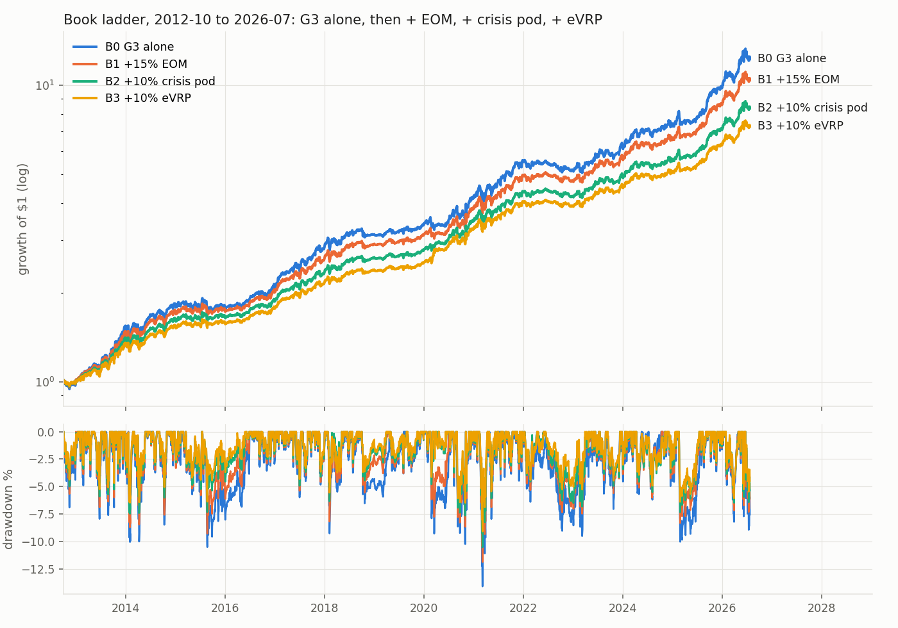
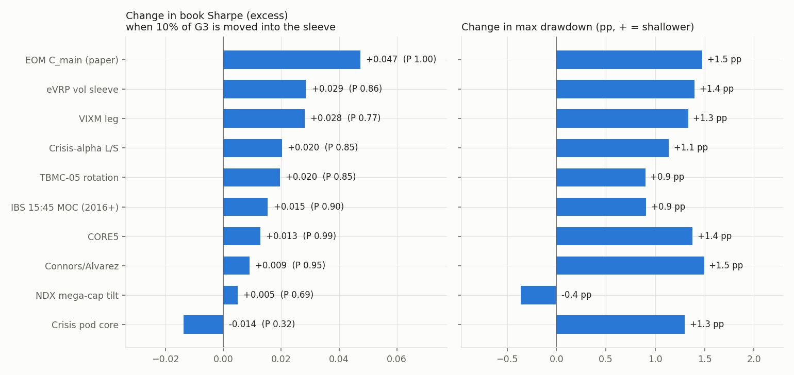

<!-- GENERATED FILE. EDIT THE CANONICAL KNOWLEDGE RECORD. -->

# Whole-book picture: true G3 core plus every paper/shadow sleeve, marginal effects and an illustrative ladder

!!! warning "Research-only"
    This page summarizes saved research evidence. It does not authorize LIVE, allocation, or deployment.

## TL;DR

> **Verdict:** G3 alone 2012-10..2026-07: 20.0%/yr, excess Sharpe 1.18 (rf0 1.30), max DD -14.1%; its two legs carry ~100% of risk. EOM C_main is the only sleeve that adds in both eras and ex-COVID (+0.07 Sharpe at 15%, DD to -11.9%). The crisis pod (5+5%) is insurance (COVID -5% -> 0%) with ~0 Sharpe effect ex-COVID. eVRP's +0.04 is mostly March 2020 (+0.01 ex). Equity sleeves (NDX tilt, TBMC-05, CORE5, Connors, IBS) add <= 0.02 by diluting vol and lose with the book in crises. Illustrative B3 (65 G3 / 15 EOM / 5 core / 5 VIXM / 10 eVRP): 15.5%/yr, excess Sharpe 1.32 (rf0 1.49), DD -9.1%; 21.9% at G3's vol with 1.5x financing. Still ~95% of risk in the G3 legs.

> **Status:** `diagnostic`

> **Disposition:** `descriptive`

> **Replication:** `not_recorded`

## Research question

Show what the book holds, what is in paper/shadow, and each sleeve's contribution to book Sharpe, drawdown and CAGR on one window.

## Exact setup

| Field | Value |
| --- | --- |
| Signal family | portfolio_construction_book_level |
| Universe | ["book level"] |
| Decision | inherited from each sleeve's own study |
| Fill | inherited; EOM MOC, others next open |
| Primary cost layer | each sleeve's own central costs; no inter-sleeve rebalancing cost |
| Last reviewed | 2026-10-14T19:01:27+00:00 |

## Timing and overnight attribution

```text
information available: inherited from each sleeve's own study
primary executable fill: inherited; EOM MOC, others next open
```

If final `Close_T` data formed the signal, a hypothetical `Close_T` entry is diagnostic only unless a separate pre-close protocol was modeled. Comparing that diagnostic with `Open_(T+1)` and applying the compounded return identity shows whether the apparent edge occurred in the overnight gap. Missing attribution numbers mean **not tested**, not zero.


## Primary metrics

| Metric | Value |
| --- | ---: |
| Period | N/A |
| Universe | N/A |
| Cost Layer | N/A |
| Cagr | N/A |
| Annualized Volatility | N/A |
| Sharpe | N/A |
| Maximum Drawdown | N/A |
| Turnover | N/A |

## Key findings

No structured feature findings were recorded.

## Visual evidence






## Limitations

- sleeves are backtests on overlapping history
- daily rebalancing without cost
- G3 TAA leg partly in-sample

## Next gates

- keep EOM paper trial as the priority add-on
- decide the crisis slot: pod (5+5) vs crisis-alpha L/S, not both, on forward shadow evidence

## Sources

- No structured source identifier recorded.

## Canonical artifacts

| Artifact | Pakal path |
| --- | --- |
| Concise Report | `pakal-research/reports/book_picture_20261014/REPORT.md` |
| Full Report | `pakal-research/reports/book_picture_20261014/REPORT_FULL.md` |
| Notebook | `pakal-research/reports/book_picture_20261014/book_picture_20261014.ipynb` |
| Frozen Specification | `pakal-research/reports/book_picture_20261014/research_spec_frozen.json` |
| Manifest | `pakal-research/reports/book_picture_20261014/run_manifest.json` |
| Primary Source Code | `["pakal-research/book_picture/bp_data.py", "pakal-research/book_picture/bp_run.py", "pakal-research/book_picture/bp_charts.py", "pakal-research/book_picture/bp_build.py"]` |
| Primary Tables | `["pakal-research/reports/book_picture_20261014/tables/sleeves.csv", "pakal-research/reports/book_picture_20261014/tables/ladder.csv", "pakal-research/reports/book_picture_20261014/tables/ladder_ex_covid.csv", "pakal-research/reports/book_picture_20261014/tables/crisis_windows.csv", "pakal-research/reports/book_picture_20261014/tables/risk_contribution_B3.csv"]` |
| Primary Charts | `["pakal-research/reports/book_picture_20261014/charts/01_ladder_equity_drawdown.png", "pakal-research/reports/book_picture_20261014/charts/02_marginal_10pct.png", "pakal-research/reports/book_picture_20261014/charts/03_crisis_windows.png"]` |
