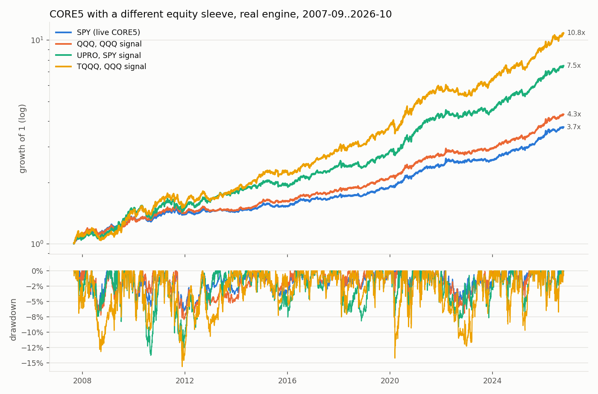
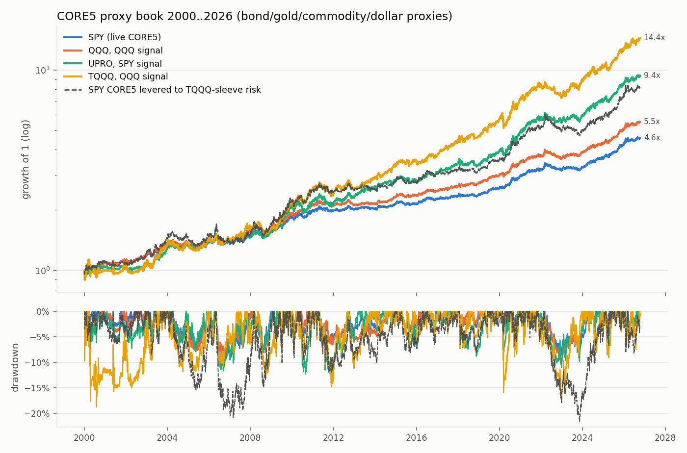

<!-- GENERATED FILE. EDIT THE CANONICAL KNOWLEDGE RECORD. -->

# CORE5 equity sleeve on QQQ / UPRO / TQQQ instead of SPY: own vs SPY signal, synthetic 3x through 2008, equal-risk whole-book leverage, 2000-2026 proxy book

!!! warning "Research-only"
    This page summarizes saved research evidence. It does not authorize LIVE, allocation, or deployment.

## TL;DR

> **Verdict:** QQQ with its own QQQ signal passes the frozen rule (Sharpe 1.02 vs 0.95, CAGR 8.0% vs 7.2%, DD -7.9% vs -6.8%; not significant after Holm) and should replace the August QQQ/SPY-signal forward line, which fails the 2000-02 check. UPRO with the SPY signal passes as a leverage dial (11.1%, Sharpe 0.99, DD -14.1%; beats whole-book leverage at equal vol, survives 2000-02 at -7%). TQQQ (13-14% CAGR 2007-26) is downgraded: the 2000-02 proxy book loses 19-31% vs -6% for equal-risk whole-book leverage. LETF-price signals are worse than underlying signals. Ladder (post hoc): S&P Sharpe flat 2x-3x; Nasdaq peaks at 1.5-2x, so QLD beats TQQQ.

> **Status:** `forward_hypothesis`

> **Disposition:** `forward_observation_only`

> **Replication:** `engine_parity_exact`

## Research question

Owner request 2026-10-11: in CORE5 replace the SPY equity sleeve with QQQ, UPRO or TQQQ.

## Exact setup

| Field | Value |
| --- | --- |
| Signal family | adaptive_trend_macro_sleeves_vehicle_swap |
| Universe | ["CORE5 ETFs SPY IEF GLD DBC UUP BIL + QQQ UPRO TQQQ SSO QLD (synthetic before inception)"] |
| Decision | Close_T (CORE5 state change or month end) |
| Fill | Open_(T+1); proxy sleeves in F6 at Close_(T+1) |
| Primary cost layer | house (2.5 bp slippage, 0.005/share) |
| Last reviewed | 2026-10-11T00:00:00+03:00 |

## Timing and overnight attribution

```text
information available: Close_T (CORE5 state change or month end)
primary executable fill: Open_(T+1); proxy sleeves in F6 at Close_(T+1)
```

If final `Close_T` data formed the signal, a hypothetical `Close_T` entry is diagnostic only unless a separate pre-close protocol was modeled. Comparing that diagnostic with `Open_(T+1)` and applying the compounded return identity shows whether the apparent edge occurred in the overnight gap. Missing attribution numbers mean **not tested**, not zero.

| Attribution field | Value |
| --- | --- |
| Status | tested |
| Diagnostic Path | F4 sleeve-only 2000-2026 and F6 proxy book |
| Executable Path | alpha_super weights engine, historical share units |
| Method | frozen spec v1 + post-hoc v1.1, block bootstrap, Holm |
| Headline Result | A2 QQQ/QQQ Sharpe 1.02 vs 0.95 (P 0.89); A3 UPRO/SPY 0.99 vs levered A0 0.88 (P 0.84) |
| Metrics | {"A0": {"cagr": 0.0716882246535837, "maxdd": -0.067786340515385, "sharpe": 0.9457900659024496}, "A1": {"cagr": 0.0808947554672403, "maxdd": -0.0767683435806572, "sharpe": 1.0411142294591218}, "A2": {"cagr": 0.0797772664766307, "maxdd": -0.0793863570963739, "sharpe": 1.023423879991189}, "A3": {"cagr": 0.111319009164696, "maxdd": -0.1414690075792026, "sharpe": 0.9929832536578536}, "A4": {"cagr": 0.1022369581282447, "maxdd": -0.1486830505995223, "sharpe": 0.9344621999583108}, "A5": {"cagr": 0.137674587327365, "maxdd": -0.1476997488035073, "sharpe": 1.0797132902245998}, "A6": {"cagr": 0.1329640417883175, "maxdd": -0.1560645497592075, "sharpe": 1.0289503374033304}, "A7": {"cagr": 0.1208170226135412, "maxdd": -0.2151183609577004, "sharpe": 0.952310535839629}, "X1": {"cagr": 0.0911592773798077, "maxdd": -0.1021983397524878, "sharpe": 0.996878851450697}, "X2": {"cagr": 0.1062714510177218, "maxdd": -0.1123627956771963, "sharpe": 1.0518736775838295}} |
| Unavailable Reason | N/A |
| Artifact | pakal-research/reports/core5_equity_vehicle_v2/tables/f1_vs_baseline.csv |

## Primary metrics

| Metric | Value |
| --- | ---: |
| Period | 2007-09-04..2026-10-09 |
| Universe | CORE5 live config, equity sleeve swapped |
| Cost Layer | N/A |
| Cagr | 7.98% |
| Annualized Volatility | 6.23% |
| Sharpe | 1.023 |
| Maximum Drawdown | -7.94% |
| Turnover | N/A |

## Four separate verdicts

| Question | Conclusion |
| --- | --- |
| Source Replication | CORE5 live config reproduced to 0.0 daily difference |
| Predictive Value | vehicle swap only; no new signal edge; own-signal benefit rests on 2000-02 |
| Economic Value | QQQ +0.8 pp CAGR at same character; UPRO +3.9 pp CAGR for double drawdown |
| Promotion | forward observation only; no PAPER/LIVE authority |

## Key findings

| Feature | Role | Direction | Status | Effect | Action |
| --- | --- | --- | --- | --- | --- |
| QQQ vehicle in the CORE5 equity sleeve | N/A | N/A | N/A | N/A | N/A |
| 3x S&P (UPRO) vehicle, SPY signal | N/A | N/A | N/A | N/A | N/A |
| 3x Nasdaq (TQQQ) vehicle | N/A | N/A | N/A | N/A | N/A |
| leverage ladder 1x-3x (synthetic daily reset) | N/A | N/A | N/A | N/A | N/A |
| signal read from the LETF price | N/A | N/A | N/A | N/A | N/A |
| LETF wrapper vs margin | N/A | N/A | N/A | N/A | N/A |
| raw vs excess Sharpe | N/A | N/A | N/A | N/A | N/A |

## Visual evidence






## Limitations

- all history seen; F6 post hoc
- 2000-02 uses proxies and synthetic LETFs
- whole-book leverage control also levers cash
- weights other than 20% not tested

## Next gates

- forward observation of A2 (QQQ/QQQ) and A3 (UPRO/SPY) beside live CORE5
- smaller TQQQ weights (e.g. 7%) only if pre-registered with a 2000-02 gate

## Sources

- `owner request 2026-10-11`
- `alpha_super alpha/scout/specs/core5.py`

## Canonical artifacts

| Artifact | Pakal path |
| --- | --- |
| Concise Report | `pakal-research/reports/core5_equity_vehicle_v2/REPORT.md` |
| Full Report | `pakal-research/reports/core5_equity_vehicle_v2/REPORT_FULL.md` |
| Notebook | `pakal-research/reports/core5_equity_vehicle_v2/core5_equity_vehicle_v2.ipynb` |
| Frozen Specification | `pakal-research/reports/core5_equity_vehicle_v2/research_spec_frozen.json` |
| Manifest | `pakal-research/reports/core5_equity_vehicle_v2/run_manifest.json` |
| Primary Source Code | `["pakal-research/core5_equity_vehicle_v2/cev2_engine.py", "pakal-research/core5_equity_vehicle_v2/cev2_proxy_book.py", "pakal-research/core5_equity_vehicle_v2/cev2_ladder.py", "pakal-research/core5_equity_vehicle_v2/cev2_ladder_stats.py", "pakal-research/core5_equity_vehicle_v2/cev2_run.py", "pakal-research/core5_equity_vehicle_v2/cev2_charts.py", "pakal-research/core5_equity_vehicle_v2/cev2_build_artifacts.py", "pakal-research/core5_equity_vehicle_v2/test_cev2_timing.py"]` |
| Primary Tables | `["pakal-research/reports/core5_equity_vehicle_v2/tables/stats_by_window.csv", "pakal-research/reports/core5_equity_vehicle_v2/tables/f1_vs_baseline.csv", "pakal-research/reports/core5_equity_vehicle_v2/tables/f2_equal_risk_leverage.csv", "pakal-research/reports/core5_equity_vehicle_v2/tables/f4_sleeve_only.csv", "pakal-research/reports/core5_equity_vehicle_v2/tables/f6_proxy_book.csv", "pakal-research/reports/core5_equity_vehicle_v2/tables/decision_rule.json"]` |
| Primary Charts | `["pakal-research/reports/core5_equity_vehicle_v2/charts/1_growth_drawdown_real.png", "pakal-research/reports/core5_equity_vehicle_v2/charts/2_growth_drawdown_proxy_2000.png", "pakal-research/reports/core5_equity_vehicle_v2/charts/3_sharpe_by_variant.png", "pakal-research/reports/core5_equity_vehicle_v2/charts/4_dotcom_drawdown.png", "pakal-research/reports/core5_equity_vehicle_v2/charts/5_leverage_ladder.png"]` |
