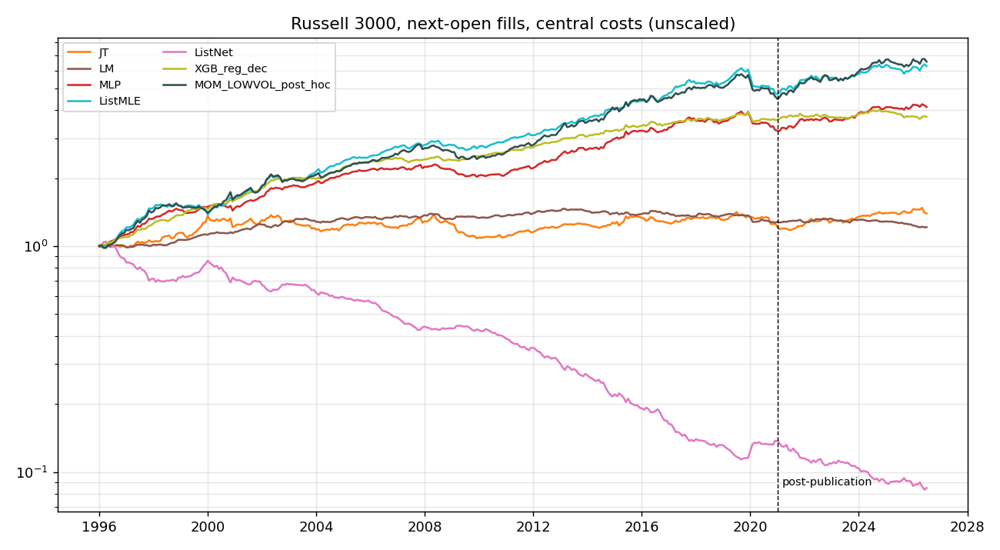
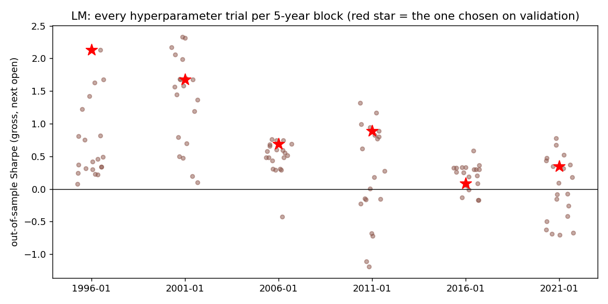

<!-- GENERATED FILE. EDIT THE CANONICAL KNOWLEDGE RECORD. -->

# Learning to rank for cross-sectional momentum (Poh-Lim-Zohren-Roberts 2020 / Aligrithm 10.23) on US PIT equities

!!! warning "Research-only"
    This page summarizes saved research evidence. It does not authorize LIVE, allocation, or deployment.

## TL;DR

> **Verdict:** Not replicated. On Russell 3000 1996-2020 (Open->Open, no costs) LambdaMART gets Sharpe 0.99 vs the paper's 2.16, ListNet and rank:ndcg are negative, and the regress-then-rank MLP the paper reports at 0.27 gets 1.34. With identical trees/features/labels, squared error beats the pairwise ranking loss by 0.81 Sharpe (SE 0.20): the paper's central mechanism reverses. The working models learn momentum plus a strong low-volatility tilt; top-weighted list losses learn volatility (who lands in the extreme decile) and lose money while winning NDCG. LambdaMART's 20 hyperparameter trials span -1.2..+2.3 Sharpe within a block; the no-selection ensemble is 0.67 before and 0.00 after 2020. After costs and T-bill financing of the net-long dollars that inverse-vol weights create, no ML model beats a two-line rank(12m) - rank(vol) rule in tradable universes, and neither beats plain 12-month momentum by more than random-book noise after 2021 (financed net Sharpe 0.31-0.50 vs JT 0.33-0.37).

> **Status:** `diagnostic`

> **Disposition:** `rejected`

> **Replication:** `not_replicated`

## Research question

Replicate the paper's claim that learning-to-rank (LambdaMART, ListNet, ListMLE, RankNet) on 22 momentum features roughly triples the Sharpe of momentum and regress-then-rank; decompose loss vs label vs learner; test what the models learn, executable costs, financing, and post-publication (2021-2026).

## Exact setup

| Field | Value |
| --- | --- |
| Signal family | cross_sectional_momentum_machine_learning_ranking |
| Universe | ["r3000 PIT (primary)", "r1000 PIT", "r3000 liquid (price >= $5, ADV >= $5M)"] |
| Decision | after final Close_T of each month |
| Fill | Open_(T+1) to Open_(T'+1); Close_T -> Close_T' paper-like diagnostic |
| Primary cost layer | central_research |
| Last reviewed | 2026-10-14T19:30:00+00:00 |

## Timing and overnight attribution

```text
information available: after final Close_T of each month
primary executable fill: Open_(T+1) to Open_(T'+1); Close_T -> Close_T' paper-like diagnostic
```

If final `Close_T` data formed the signal, a hypothetical `Close_T` entry is diagnostic only unless a separate pre-close protocol was modeled. Comparing that diagnostic with `Open_(T+1)` and applying the compounded return identity shows whether the apparent edge occurred in the overnight gap. Missing attribution numbers mean **not tested**, not zero.

| Attribution field | Value |
| --- | --- |
| Status | tested |
| Diagnostic Path | Close_T -> Close_T' |
| Executable Path | Open_(T+1) -> Open_(T'+1) |
| Headline Result | paper-like minus executable Sharpe within +-0.12 for every non-random model (median 0.00); timing is not the explanation |
| Artifact | pakal-research/reports/ltr_momentum_study/tables/table_executable.csv |

## Primary metrics

| Metric | Value |
| --- | ---: |
| Period | 1996-01 to 2026-07 formation months (6 frozen 5-year walk-forward blocks) |
| Universe | Russell 3000 PIT, top/bottom 10%, w = 0.15/sigma_i/n per side |
| Cost Layer | central_research: 10 bps per side + 200 bps/yr borrow |
| Cagr | N/A |
| Annualized Volatility | N/A |
| Sharpe | N/A |
| Maximum Drawdown | N/A |
| Turnover | N/A |

## Four separate verdicts

| Question | Conclusion |
| --- | --- |
| Source Replication | fails: LM 0.99 vs 2.16, ListNet -0.76 vs 1.97, MLP 1.34 vs 0.27 (Russell 3000, 1996-2020, gross) |
| Predictive Value | real but it is momentum + low volatility; decays strongly after 2005; tree models collapse after 2020 |
| Economic Value | fails: H1 Holm p = 1 in all 4 cells; LM post-2021 net central -0.33 |
| Promotion | none |

## Key findings

| Feature | Role | Direction | Status | Effect | Action |
| --- | --- | --- | --- | --- | --- |
| LambdaMART rank:pairwise on 22 momentum features, decile labels | signal | long top decile of score | rejected | gross Sharpe 0.99 (1996-2020), 0.35 (2021-26); net central 0.33 / -0.33 | do not use |
| Top-weighted list losses (ListNet softmax over decile labels; XGBoost rank:ndcg) | signal | n/a | rejected | gross Sharpe -0.76 / -0.34 (1996-2020) with the best long-side NDCG of all models | never use extreme-decile relevance labels for return ranking |
| Regress-then-rank MLP / ListMLE on per-month z-scored features | signal | long top decile | diagnostic | R3000 gross 1.3 / 1.2-1.0 post 2021; R1000 MLP post-2021 net 0.08 | diagnostic only |
| rank(ret_252) - rank(vol_63 EWM), inverse-vol weighted long-short (post hoc) | signal | long strong + calm | forward_hypothesis | R1000 net central financed 0.65 (1996-2020), 0.47 (2021-26); JT 0.26 / 0.37 | fold into TBMC-05 two-factor rotation review; no separate study |

## Visual evidence






## Limitations

- no CRSP NYSE codes 10/11; Russell PIT 1992-2026; no delisting returns
- reduced hyperparameter budget (20/10 XGBoost trials, 5 neural trials vs 50) and narrower nets
- numpy re-implementation of RankNet/ListNet/ListMLE (gradients unit-tested)
- capacity not modelled

## Next gates

- none for LTR; optionally review rank(12m) - rank(vol) only inside the existing TBMC-05 two-factor rotation shadow

## Sources

- `pakal-research/sources/ltr_momentum/aligrithm_10_23_learning_to_rank_2026-10-14.pdf \| sha256:a8a06d5d34cf77a47e919e43ca5ac02b3746a9a934772f390d32122d4c31a3cc`
- `https://arxiv.org/abs/2012.07149 (Poh, Lim, Zohren, Roberts 2020, v1)`

## Canonical artifacts

| Artifact | Pakal path |
| --- | --- |
| Concise Report | `pakal-research/reports/ltr_momentum_study/REPORT.md` |
| Full Report | `pakal-research/reports/ltr_momentum_study/REPORT_FULL.md` |
| Notebook | `pakal-research/reports/ltr_momentum_study/ltr_momentum_study.ipynb` |
| Frozen Specification | `pakal-research/reports/ltr_momentum_study/research_spec_frozen.json` |
| Manifest | `pakal-research/reports/ltr_momentum_study/run_manifest.json` |
| Research State | `pakal-research/reports/ltr_momentum_study/research_state.json` |
| Hypothesis Registry | `pakal-research/reports/ltr_momentum_study/hypothesis_registry.json` |
| Experiment Ledger | `pakal-research/reports/ltr_momentum_study/experiment_ledger.jsonl` |
| Decision Log | `pakal-research/reports/ltr_momentum_study/decision_log.jsonl` |
| Source Rule Map | `pakal-research/reports/ltr_momentum_study/SOURCE_RULE_MAP.md` |
| Primary Source Code | `["pakal-research/ltr_momentum/ltr_lib.py", "pakal-research/ltr_momentum/ltr_models.py", "pakal-research/ltr_momentum/ltr_run.py", "pakal-research/ltr_momentum/ltr_charts.py", "pakal-research/ltr_momentum/test_ltr_timing.py", "pakal-research/ltr_momentum/ltr_build_artifacts.py"]` |
| Primary Tables | `["pakal-research/reports/ltr_momentum_study/tables/table_paper_comparison.csv", "pakal-research/reports/ltr_momentum_study/tables/table_executable.csv", "pakal-research/reports/ltr_momentum_study/tables/table_tests_H1_H2.csv", "pakal-research/reports/ltr_momentum_study/tables/table_spanning_H3.csv", "pakal-research/reports/ltr_momentum_study/tables/table_trial_luck.csv", "pakal-research/reports/ltr_momentum_study/tables/table_score_loadings.csv"]` |
| Primary Charts | `["pakal-research/reports/ltr_momentum_study/charts/08_all_models_by_era_r3000.png", "pakal-research/reports/ltr_momentum_study/charts/02_exec_net_central_r3000.png", "pakal-research/reports/ltr_momentum_study/charts/06_trial_luck_lm_r3000.png", "pakal-research/reports/ltr_momentum_study/charts/07_score_loadings_r3000.png"]` |
