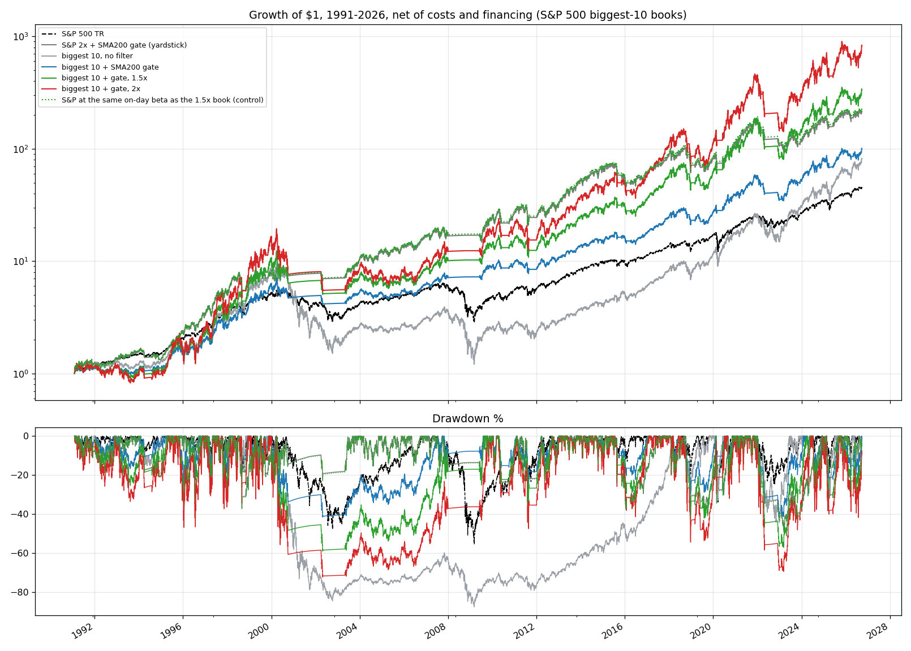
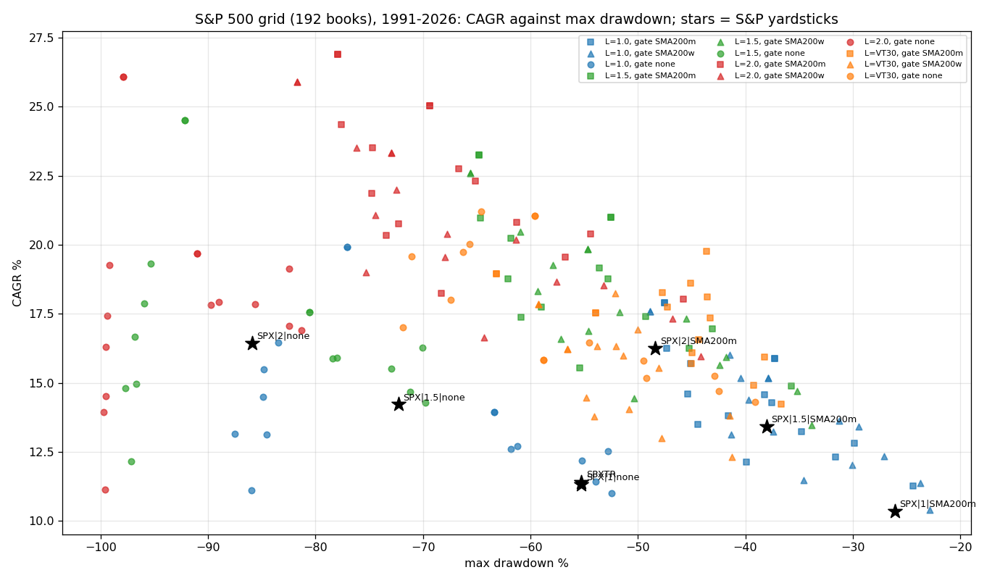

<!-- GENERATED FILE. EDIT THE CANONICAL KNOWLEDGE RECORD. -->

# Mega-cap concentration as a beta boost: biggest-N S&P 500 / Nasdaq-100 books with trend gates and leverage against the S&P at matched beta, plus a century of CRSP size deciles

!!! warning "Research-only"
    This page summarizes saved research evidence. It does not authorize LIVE, allocation, or deployment.

## TL;DR

> **Verdict:** REJECTED AS ALPHA, ACCEPTED AS BETA. Against the S&P 500 held at the same on-day beta, the biggest-10 S&P 500 book adds 1.9 pp/yr (t 1.0, Holm p 0.80); no primary member passes the frozen rule. The gain is a 2009-2026 regime (biggest-10 gated: -0.7 pp/yr vs control in 1991-2008, +4.5 pp/yr in 2009-2026); over 1926-2026 the largest CRSP decile trailed the market by 0.4 pp/yr and concentration is at a century high. A levered gated S&P (2x + SMA200: 16.3%/yr, DD -48%) delivers the boost with less risk than the 2x gated biggest-10 (20.7%/yr, DD -72%, beta 2.7). Regime timing adds nothing (Holm p 1). Forward hypothesis only: a 3-year turnover size proxy (t 2.7) and the Nasdaq-100 universe.

> **Status:** `diagnostic`

> **Disposition:** `rejected`

> **Replication:** `owner_hypothesis_not_supported`

## Research question

Owner goal: a very large CAGR boost through deliberately high beta in the largest US stocks. Test whether concentration adds CAGR beyond beta, whether the mega-cap premium is structural, and whether the regime can be timed.

## Exact setup

| Field | Value |
| --- | --- |
| Signal family | size_concentration_beta_overlay |
| Universe | ["S&P 500 PIT (primary), Nasdaq-100 PIT (secondary), S&P 100 pool as a cap proxy; $5 raw floor; delisted names included", "CRSP size deciles 1926-2026 (Ken French) for the century context"] |
| Decision | Close_t at month end (selection, gate, leverage); weekly-gate variant re-reads the gate at week ends |
| Fill | Close_(t+1) MOC; robustness Open_(t+1) |
| Primary cost layer | central_research |
| Last reviewed | 2026-10-10T00:00:00+03:00 |

## Timing and overnight attribution

```text
information available: Close_t at month end (selection, gate, leverage); weekly-gate variant re-reads the gate at week ends
primary executable fill: Close_(t+1) MOC; robustness Open_(t+1)
```

If final `Close_T` data formed the signal, a hypothetical `Close_T` entry is diagnostic only unless a separate pre-close protocol was modeled. Comparing that diagnostic with `Open_(T+1)` and applying the compounded return identity shows whether the apparent edge occurred in the overnight gap. Missing attribution numbers mean **not tested**, not zero.

| Attribution field | Value |
| --- | --- |
| Status | tested |
| Diagnostic Path | century regressions on CRSP deciles (overlapping 12m, NW) |
| Executable Path | stateful monthly/weekly engine with leverage, drift, financing and tiered costs; beta-matched S&P controls |
| Method | frozen v1 spec + v1.1 control amendment, 244 books, primary family 8 tests Holm, bootstrap, secondary 6+1 |
| Headline Result | biggest-10 gated vs S&P at beta 1.34: 1.9 pp/yr, t 0.99, Holm p 0.80 |
| Metrics | {"big10_gate_diff_t_nw": 0.9932564952016772, "big10_gate_holm_p": 0.8014624321179714, "grid_share_t_gt_2": 0.24479166666666666} |
| Unavailable Reason | N/A |
| Artifact | pakal-research/reports/megacap_concentration_beta_boost/tables/primary_family_holm_v11.csv |

## Primary metrics

| Metric | Value |
| --- | ---: |
| Period | 1991-02-04..2026-09-25 |
| Universe | S&P 500 biggest 10 by 252d turnover, EW, SMA200 gate, 1x (primary member) |
| Cost Layer | central_research (5 bps per side for mega-caps; borrowing %3MTCM + 1%) |
| Cagr | 13.80% |
| Annualized Volatility | 20.35% |
| Sharpe | 0.607 |
| Maximum Drawdown | -41.56% |
| Turnover | N/A |

## Four separate verdicts

| Question | Conclusion |
| --- | --- |
| Source Replication | owner hypothesis; two prior exploratory rounds (biggest_n_trend_gate) disclosed in the spec |
| Predictive Value | mega-cap tilt positive after 2009 only; century relative momentum t 2.9 but tiny; concentration level does not predict |
| Economic Value | none beyond beta after costs and financing; the levered gated index dominates on drawdown |
| Promotion | none; shadow-only idea: 756-day proxy, N 5-10, SMA200 gate, CORE5 per stock, 1.5x |

## Key findings

| Feature | Role | Direction | Status | Effect | Action |
| --- | --- | --- | --- | --- | --- |
| biggest-N selection (turnover proxy), N 3-20 | N/A | N/A | N/A | N/A | N/A |
| index SMA200 gate (monthly / weekly) | N/A | N/A | N/A | N/A | N/A |
| CORE5 per stock | N/A | N/A | N/A | N/A | N/A |
| constant leverage 1.5x / 2x, VT30 | N/A | N/A | N/A | N/A | N/A |
| relative-strength regime switch (6/12/36m) and concentration-change switch | N/A | N/A | N/A | N/A | N/A |
| century: largest CRSP decile vs market | N/A | N/A | N/A | N/A | N/A |
| 3-year turnover size proxy | N/A | N/A | N/A | N/A | N/A |
| Addendum: gate + CORE5 biggest-10 vs own gated index at matched beta, with leverage (owner's Sharpe-first target) | N/A | N/A | N/A | N/A | N/A |
| Addendum 2: vol-targeted leverage (20/25/30%, cap 2x) on gate + CORE5 biggest-10 vs own gated index | N/A | N/A | N/A | N/A | N/A |

## Visual evidence






## Limitations

- no PIT market cap (dollar-turnover proxy with an attention tilt)
- monthly leverage reset, no intramonth margin calls
- stock-book borrowing at T-bill + 1% (index futures would be cheaper)
- delisting returns after the last bar not modelled
- two exploratory rounds preceded the frozen spec; v1.1 control amendment after seeing v1

## Next gates

- Pre-registered 'levered gated Nasdaq-100 + half-sized mega-cap tilt' sleeve: 50% gated NQ/QQQ + 50% biggest-10 NDX by 3-year turnover with CORE5 per stock, constant 1.5x, SMA200 monthly gate, NQ financing for the index half; locked 2016-2026 holdout and walk-forward; then 6-month paper shadow beside the crisis-trend hedge pod
- untested guardrails to specify before live: 20% per-name cap, de-lever to 1x after a -25% drawdown until a new high, faster (weekly) exit with monthly re-entry

## Sources

- `Owner request 2026-10-10 (chat, Hebrew)`
- `Ken French data library, Portfolios Formed on ME (CRSP 202605)`
- `alpha_super alpha/scout/specs/core5.py (CORE5 adaptive trend)`
- `pakal-research/biggest_n_trend_gate (rounds 1-2, same day)`

## Canonical artifacts

| Artifact | Pakal path |
| --- | --- |
| Concise Report | `pakal-research/reports/megacap_concentration_beta_boost/REPORT.md` |
| Full Report | `pakal-research/reports/megacap_concentration_beta_boost/REPORT_FULL.md` |
| Notebook | `pakal-research/reports/megacap_concentration_beta_boost/megacap_concentration_beta_boost.ipynb` |
| Frozen Specification | `pakal-research/reports/megacap_concentration_beta_boost/research_spec_frozen.json` |
| Manifest | `pakal-research/reports/megacap_concentration_beta_boost/run_manifest.json` |
| Primary Source Code | `["pakal-research/megacap_concentration_beta_boost/mcbb_lib.py", "pakal-research/megacap_concentration_beta_boost/mcbb_run.py", "pakal-research/megacap_concentration_beta_boost/mcbb_controls_v11.py", "pakal-research/megacap_concentration_beta_boost/mcbb_charts.py", "pakal-research/megacap_concentration_beta_boost/mcbb_build_artifacts.py", "pakal-research/megacap_concentration_beta_boost/test_mcbb_timing.py", "pakal-research/megacap_concentration_beta_boost/mcbb_addendum_sharpe_first.py", "pakal-research/megacap_concentration_beta_boost/mcbb_addendum_voltarget.py"]` |
| Primary Tables | `["pakal-research/reports/megacap_concentration_beta_boost/tables/primary_family_holm_v11.csv", "pakal-research/reports/megacap_concentration_beta_boost/tables/primary_family_holm.csv", "pakal-research/reports/megacap_concentration_beta_boost/tables/book_stats.csv", "pakal-research/reports/megacap_concentration_beta_boost/tables/yardstick_stats.csv", "pakal-research/reports/megacap_concentration_beta_boost/tables/neighborhood_summary_v11.csv", "pakal-research/reports/megacap_concentration_beta_boost/tables/secondary_regime_holm.csv", "pakal-research/reports/megacap_concentration_beta_boost/tables/french_decades.csv", "pakal-research/reports/megacap_concentration_beta_boost/tables/french_regressions.csv", "pakal-research/reports/megacap_concentration_beta_boost/tables/french_switch.csv", "pakal-research/reports/megacap_concentration_beta_boost/tables/addendum_sharpe_first.csv", "pakal-research/reports/megacap_concentration_beta_boost/tables/addendum_voltarget.csv"]` |
| Primary Charts | `["pakal-research/reports/megacap_concentration_beta_boost/charts/1_growth_drawdown_key_books.png", "pakal-research/reports/megacap_concentration_beta_boost/charts/3_primary_family_vs_control.png", "pakal-research/reports/megacap_concentration_beta_boost/charts/2_grid_cagr_vs_maxdd.png", "pakal-research/reports/megacap_concentration_beta_boost/charts/5_french_century.png", "pakal-research/reports/megacap_concentration_beta_boost/charts/9_addendum_sharpe_first.png"]` |
