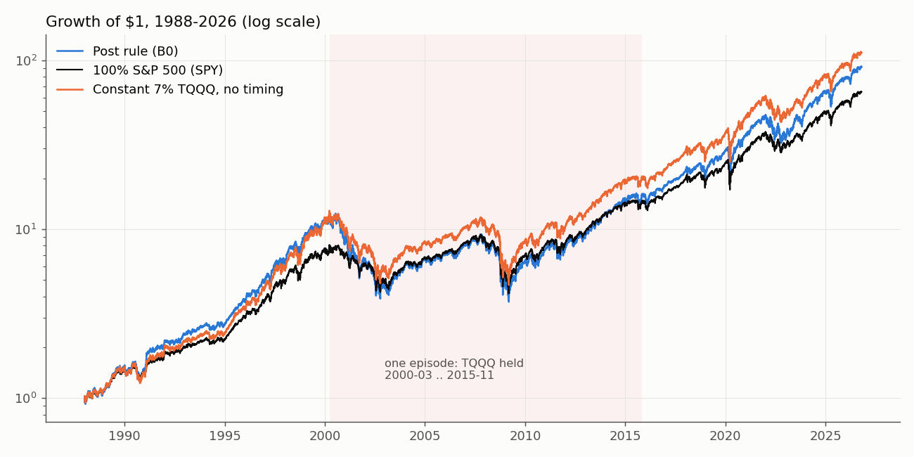
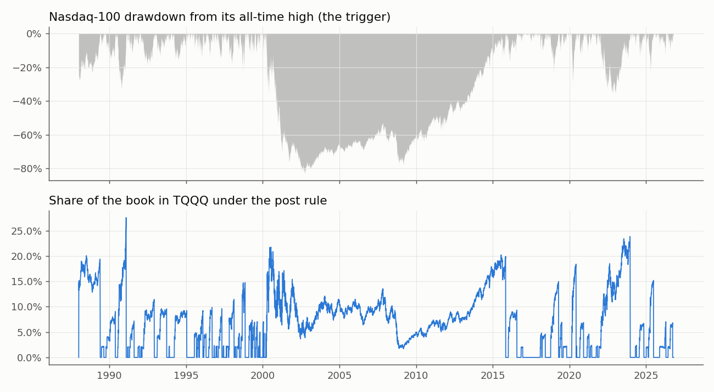

<!-- GENERATED FILE. EDIT THE CANONICAL KNOWLEDGE RECORD. -->

# NDX dip ladder into TQQQ: 100% S&P, 2% into 3x Nasdaq at -5% and each further -3%, back to 100% S&P at the old NDX peak

!!! warning "Research-only"
    This page summarizes saved research evidence. It does not authorize LIVE, allocation, or deployment.

## TL;DR

> **Verdict:** Rejected. 1988-2026: B0 12.3%/yr, Sharpe 0.50, max DD -70% vs SPY 11.4%, 0.52, -55%. The extra return is leverage (average 7% TQQQ, ~1.2x): SPY levered to B0's risk earns 12.7% and constant 7% TQQQ without timing 12.9%/0.54/-64%. H1-H3 all fail (Holm). 56 of 57 dip episodes win small; the 2000-2015 episode (NDX -83%, 26 tranches, 15.6 years held) loses 54% of the book vs SPY. Wins 1988-99 and 2010-26, loses 2000-09; 10-year windows starting 1990-99 trail SPY 89% of the time. 0/36 grid cells beat SPY's Sharpe in all three eras.

> **Status:** `diagnostic`

> **Disposition:** `rejected`

> **Replication:** `claim_not_supported`

## Research question

Test a social-post claim that laddering S&P money into TQQQ on Nasdaq-100 drawdowns beats the index systematically and in every decade; test variants (thresholds, tranche size, vehicle, exits, caps, trend gate, S&P/UPRO, timing).

## Exact setup

| Field | Value |
| --- | --- |
| Signal family | drawdown_ladder_leveraged_dip_buying |
| Universe | ["SPY + TQQQ (synthetic 3x NDX TR before 2010-02-11)", "variants: QQQ, QLD, UPRO"] |
| Decision | after Close_T of $NDX |
| Fill | Close_(T+1); sensitivity Close_T (MOC) and Close_(T+5) |
| Primary cost layer | central_research |
| Last reviewed | 2026-10-16T06:38:22+00:00 |

## Timing and overnight attribution

```text
information available: after Close_T of $NDX
primary executable fill: Close_(T+1); sensitivity Close_T (MOC) and Close_(T+5)
```

If final `Close_T` data formed the signal, a hypothetical `Close_T` entry is diagnostic only unless a separate pre-close protocol was modeled. Comparing that diagnostic with `Open_(T+1)` and applying the compounded return identity shows whether the apparent edge occurred in the overnight gap. Missing attribution numbers mean **not tested**, not zero.

| Attribution field | Value |
| --- | --- |
| Status | tested |
| Diagnostic Path | Close_T fill |
| Executable Path | Close_(T+1) fill |
| Headline Result | full-window Sharpe 0.512 (same day) vs 0.503 (next day) vs 0.504 (5 days late) |
| Artifact | pakal-research/reports/ndx_dip_ladder_tqqq_study/tables/table_variants.csv |

## Primary metrics

| Metric | Value |
| --- | ---: |
| Period | 1988-01-04..2026-10-15 |
| Universe | N/A |
| Cost Layer | N/A |
| Cagr | N/A |
| Annualized Volatility | N/A |
| Sharpe | N/A |
| Maximum Drawdown | N/A |
| Turnover | N/A |

## Four separate verdicts

| Question | Conclusion |
| --- | --- |
| Source Replication | claim not supported: beats SPY in raw return only, not in every decade, not at equal risk |
| Predictive Value | none: random-date placebo Sharpe median 0.51 vs B0 0.50; constant weight beats dip timing |
| Economic Value | fails: H2 Sharpe diff -0.015 (p 0.65) |
| Promotion | none |

## Key findings

| Feature | Role | Direction | Status | Effect | Action |
| --- | --- | --- | --- | --- | --- |
| NDX drawdown ladder into TQQQ (5% start, 3% step, 2% tranches, exit at old peak) | exposure/sizing | add leverage after drawdowns | rejected | CAGR +0.9 pp, Sharpe -0.015, max DD -15 pp vs SPY | do not use; a constant small leverage slice dominates it |
| Half-retrace exit (E1) for dip ladders | exit | sell leverage when half of the drawdown is recovered | diagnostic | max DD equal to SPY, Sharpe +0.005, CAGR +0.4 pp | only form of the ladder that adds no drawdown; not worth running |

## Visual evidence






## Limitations

- synthetic TQQQ before 2010; index-based S&P before 1993; constant NDX dividend yield before 1999
- 1988 start inside the post-1987 drawdown (B0 opens with 8 tranches)
- taxes ignored
- author's own simulations unavailable

## Next gates

- none

## Sources

- `pakal-research/reports/ndx_dip_ladder_tqqq_study/sources/post_screenshot.webp \| sha256:91d0aa959844b87a1ebde99881f5c844bbe0de09bd52ae0a55437ae53d6a1544`

## Canonical artifacts

| Artifact | Pakal path |
| --- | --- |
| Concise Report | `pakal-research/reports/ndx_dip_ladder_tqqq_study/REPORT.md` |
| Full Report | `pakal-research/reports/ndx_dip_ladder_tqqq_study/REPORT_FULL.md` |
| Notebook | `pakal-research/reports/ndx_dip_ladder_tqqq_study/ndx_dip_ladder_tqqq_study.ipynb` |
| Frozen Specification | `pakal-research/reports/ndx_dip_ladder_tqqq_study/research_spec_frozen.json` |
| Manifest | `pakal-research/reports/ndx_dip_ladder_tqqq_study/run_manifest.json` |
| Decision Log | `pakal-research/reports/ndx_dip_ladder_tqqq_study/decision_log.jsonl` |
| Primary Source Code | `["pakal-research/ndx_dip_ladder/ndl_lib.py", "pakal-research/ndx_dip_ladder/ndl_run.py", "pakal-research/ndx_dip_ladder/ndl_charts.py", "pakal-research/ndx_dip_ladder/test_ndl_timing.py", "pakal-research/ndx_dip_ladder/ndl_build_artifacts.py"]` |
| Primary Tables | `["pakal-research/reports/ndx_dip_ladder_tqqq_study/tables/table_main.csv", "pakal-research/reports/ndx_dip_ladder_tqqq_study/tables/table_tests.csv", "pakal-research/reports/ndx_dip_ladder_tqqq_study/tables/table_variants.csv", "pakal-research/reports/ndx_dip_ladder_tqqq_study/tables/table_equal_vol_spy.csv", "pakal-research/reports/ndx_dip_ladder_tqqq_study/tables/table_episodes_b0.csv", "pakal-research/reports/ndx_dip_ladder_tqqq_study/tables/table_stress_2000_peak.csv", "pakal-research/reports/ndx_dip_ladder_tqqq_study/tables/table_rolling10y.csv"]` |
| Primary Charts | `["pakal-research/reports/ndx_dip_ladder_tqqq_study/charts/01_equity_curves.png", "pakal-research/reports/ndx_dip_ladder_tqqq_study/charts/02_drawdown_and_weight.png", "pakal-research/reports/ndx_dip_ladder_tqqq_study/charts/03_episode_payoffs.png", "pakal-research/reports/ndx_dip_ladder_tqqq_study/charts/04_rolling_10y.png", "pakal-research/reports/ndx_dip_ladder_tqqq_study/charts/05_grid_by_era.png", "pakal-research/reports/ndx_dip_ladder_tqqq_study/charts/06_placebo_sharpe.png"]` |
