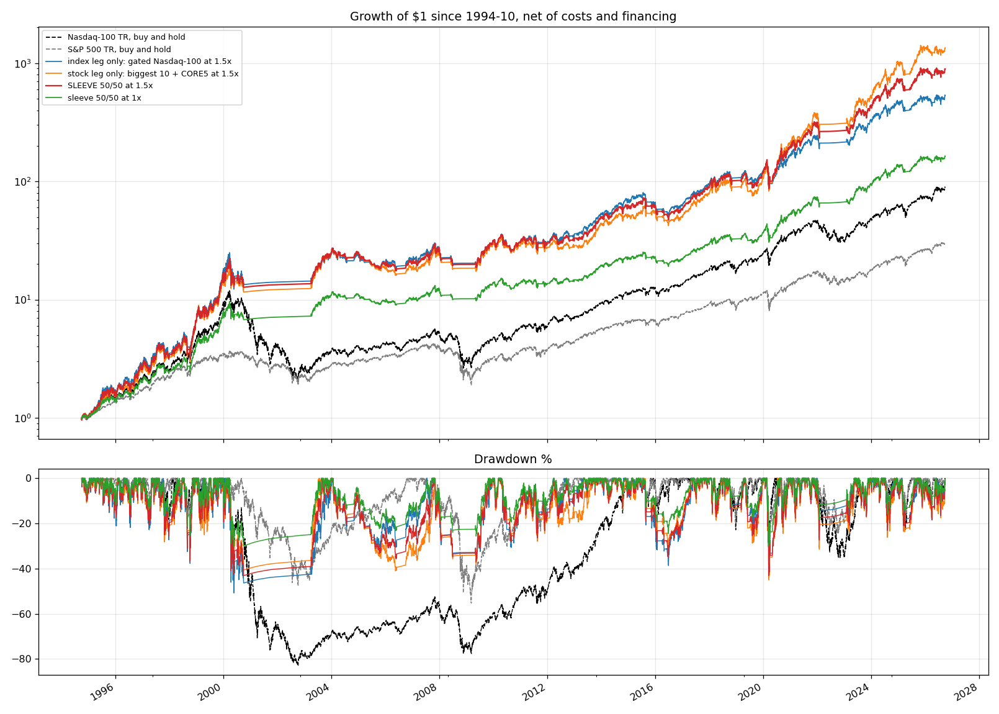
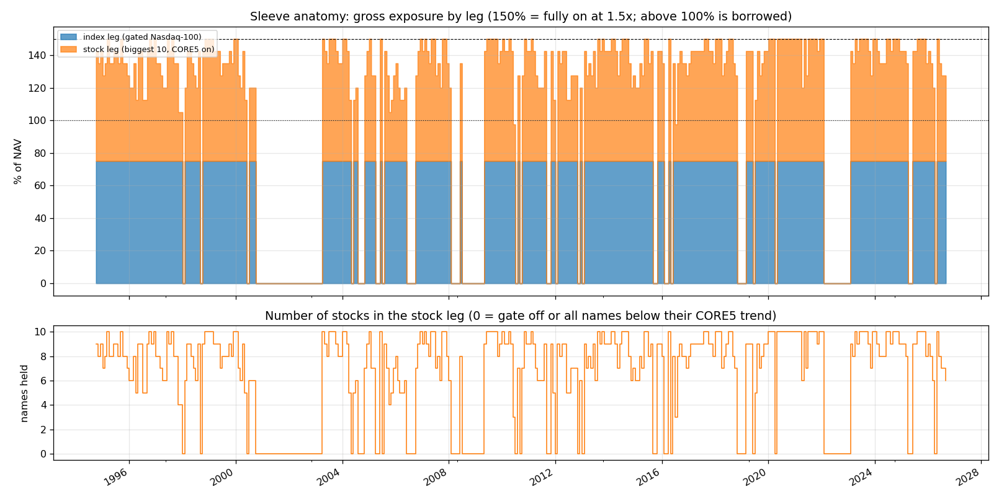

<!-- GENERATED FILE. EDIT THE CANONICAL KNOWLEDGE RECORD. -->

# Levered gated Nasdaq-100 with a half-sized mega-cap tilt (biggest 10 by 3-year turnover, CORE5 per stock, SMA200 gate, 1.5x): pre-registered sleeve with walk-forward

!!! warning "Research-only"
    This page summarizes saved research evidence. It does not authorize LIVE, allocation, or deployment.

## TL;DR

> **Verdict:** PROMOTED TO PAPER SHADOW by the pre-registered rule. Sleeve 1994-2026: CAGR 23.7%, Sharpe 0.79, max DD -43% vs the levered gated index alone 21.7% / 0.72 / -51%. Sharpe gain bootstrap P 0.95; CAGR difference t 1.3 (Holm p 0.35, not significant). The tilt did not hurt in 1995-2008 (Sharpe 0.71 vs 0.68); walk-forward OOS Sharpe 0.68 vs index leg 0.62. Guardrails (weekly exit, drawdown de-lever) rejected. Leverage is a clean dial (Sharpe flat 0.79-0.80 from 1x to 2x).

> **Status:** `forward_hypothesis`

> **Disposition:** `paper_shadow`

> **Replication:** `owner_sleeve_passes_pre_registered_rule`

## Research question

Owner goal: high CAGR with a good Sharpe through the biggest names. Pre-registered test of the sleeve suggested by megacap_concentration_beta_boost: 50% gated Nasdaq-100 index + 50% biggest-10 with CORE5 per stock, constant 1.5x.

## Exact setup

| Field | Value |
| --- | --- |
| Signal family | levered_trend_gated_index_with_size_tilt |
| Universe | ["Nasdaq-100 PIT (primary), S&P 500 PIT (secondary); index leg QQQ TR / $SPXTR"] |
| Decision | Close_t at month end (gate, selection, leverage); weekly-exit variant reads the gate at week ends (rejected) |
| Fill | Close_(t+1) MOC; Open_(t+1) sensitivity |
| Primary cost layer | central_research |
| Last reviewed | 2026-10-10T00:00:00+03:00 |

## Timing and overnight attribution

```text
information available: Close_t at month end (gate, selection, leverage); weekly-exit variant reads the gate at week ends (rejected)
primary executable fill: Close_(t+1) MOC; Open_(t+1) sensitivity
```

If final `Close_T` data formed the signal, a hypothetical `Close_T` entry is diagnostic only unless a separate pre-close protocol was modeled. Comparing that diagnostic with `Open_(T+1)` and applying the compounded return identity shows whether the apparent edge occurred in the overnight gap. Missing attribution numbers mean **not tested**, not zero.

| Attribution field | Value |
| --- | --- |
| Status | tested |
| Diagnostic Path | walk-forward tilt choice from trailing 10y / 5y Sharpe, OOS 2005-2026 |
| Executable Path | stateful monthly engine with leverage, drift, financing, tiered costs; NAV-at-decision state for the drawdown rule |
| Method | frozen spec, 131 books, 4 + 4 Holm tests, block bootstrap, walk-forward, guardrail rule |
| Headline Result | sleeve vs index leg: Sharpe 0.79 vs 0.72, boot P 0.95, CAGR diff t 1.29 |
| Metrics | {"boot_p_sharpe": 0.9505, "cagr_diff_t_nw": 1.289911956375802, "sleeve_sharpe": 0.7944021363516469, "tilt0_sharpe": 0.722954453009264, "wf10_oos_sharpe": 0.6830479361809247} |
| Unavailable Reason | N/A |
| Artifact | pakal-research/reports/ndx_megacap_tilt_sleeve/tables/primary_family_holm.csv |

## Primary metrics

| Metric | Value |
| --- | ---: |
| Period | 1994-10-03..2026-09-25 |
| Universe | Nasdaq-100, sleeve 50/50 at 1.5x, 3-year turnover proxy, CORE5 per stock, SMA200 monthly gate |
| Cost Layer | central_research (5 bps stocks, 2 bps index per side; borrowing %3MTCM + 1%) |
| Cagr | 23.71% |
| Annualized Volatility | 28.91% |
| Sharpe | 0.794 |
| Maximum Drawdown | -43.17% |
| Turnover | N/A |

## Four separate verdicts

| Question | Conclusion |
| --- | --- |
| Source Replication | owner sleeve, pre-registered; tilt direction known from the parent study (disclosed) |
| Predictive Value | tilt Sharpe gain is 2009-2026; CORE5 per stock lowers drawdown in every era |
| Economic Value | Sharpe +0.07 and DD -8 pp over the levered gated index after costs and financing; CAGR +2 pp not significant |
| Promotion | paper shadow 6 months beside the crisis-trend hedge pod; live only after the shadow and a sizing decision |

## Key findings

| Feature | Role | Direction | Status | Effect | Action |
| --- | --- | --- | --- | --- | --- |
| mega-cap tilt 0-100% of the book (biggest 10 NDX by 3y turnover) | N/A | N/A | N/A | N/A | N/A |
| CORE5 per stock inside the stock leg | N/A | N/A | N/A | N/A | N/A |
| constant leverage 1-2x on the gated sleeve | N/A | N/A | N/A | N/A | N/A |
| weekly exit / drawdown de-lever guardrails | N/A | N/A | N/A | N/A | N/A |
| walk-forward tilt choice (trailing 10y / 5y Sharpe) | N/A | N/A | N/A | N/A | N/A |
| 3-year vs 1-year turnover proxy | N/A | N/A | N/A | N/A | N/A |

## Visual evidence






## Limitations

- tilt direction known before the study (holdout contaminated, disclosed)
- turnover size proxy, not market cap
- monthly leverage reset, no intramonth margin calls
- $NDX price index for the 1994-1999 index leg
- delisting returns after the last bar not modelled

## Next gates

- 6-month paper shadow beside the crisis-trend hedge pod: monthly decisions, log holdings, gate state, gross and realized slippage
- sizing in the book: correlation with the NDX family pods and the tail-hedge budget at 1.5x
- financing the index leg with NQ futures (spread ~0.3-0.5%) and the stock leg on margin: realized cost audit

## Sources

- `Owner request 2026-10-10 (chat, Hebrew)`
- `pakal-research/reports/megacap_concentration_beta_boost (parent study, same day)`
- `alpha_super alpha/scout/specs/core5.py`

## Canonical artifacts

| Artifact | Pakal path |
| --- | --- |
| Concise Report | `pakal-research/reports/ndx_megacap_tilt_sleeve/REPORT.md` |
| Full Report | `pakal-research/reports/ndx_megacap_tilt_sleeve/REPORT_FULL.md` |
| Notebook | `pakal-research/reports/ndx_megacap_tilt_sleeve/ndx_megacap_tilt_sleeve.ipynb` |
| Frozen Specification | `pakal-research/reports/ndx_megacap_tilt_sleeve/research_spec_frozen.json` |
| Manifest | `pakal-research/reports/ndx_megacap_tilt_sleeve/run_manifest.json` |
| Primary Source Code | `["pakal-research/ndx_megacap_tilt_sleeve/nmts_lib.py", "pakal-research/ndx_megacap_tilt_sleeve/nmts_run.py", "pakal-research/ndx_megacap_tilt_sleeve/nmts_charts.py", "pakal-research/ndx_megacap_tilt_sleeve/nmts_build_artifacts.py", "pakal-research/ndx_megacap_tilt_sleeve/test_nmts_timing.py", "pakal-research/megacap_concentration_beta_boost/mcbb_lib.py"]` |
| Primary Tables | `["pakal-research/reports/ndx_megacap_tilt_sleeve/tables/primary_family_holm.csv", "pakal-research/reports/ndx_megacap_tilt_sleeve/tables/decision_rule.json", "pakal-research/reports/ndx_megacap_tilt_sleeve/tables/book_stats.csv", "pakal-research/reports/ndx_megacap_tilt_sleeve/tables/walk_forward.csv", "pakal-research/reports/ndx_megacap_tilt_sleeve/tables/guardrails.csv", "pakal-research/reports/ndx_megacap_tilt_sleeve/tables/ladders_ndx.csv", "pakal-research/reports/ndx_megacap_tilt_sleeve/tables/crisis_returns.csv", "pakal-research/reports/ndx_megacap_tilt_sleeve/tables/yearly_returns.csv", "pakal-research/reports/ndx_megacap_tilt_sleeve/tables/primary_sleeve_exposure.csv"]` |
| Primary Charts | `["pakal-research/reports/ndx_megacap_tilt_sleeve/charts/1_growth_drawdown.png", "pakal-research/reports/ndx_megacap_tilt_sleeve/charts/2_sleeve_anatomy.png", "pakal-research/reports/ndx_megacap_tilt_sleeve/charts/3_tilt_ladder.png", "pakal-research/reports/ndx_megacap_tilt_sleeve/charts/4_leverage_ladder.png", "pakal-research/reports/ndx_megacap_tilt_sleeve/charts/5_walk_forward.png", "pakal-research/reports/ndx_megacap_tilt_sleeve/charts/9_primary_family.png"]` |
