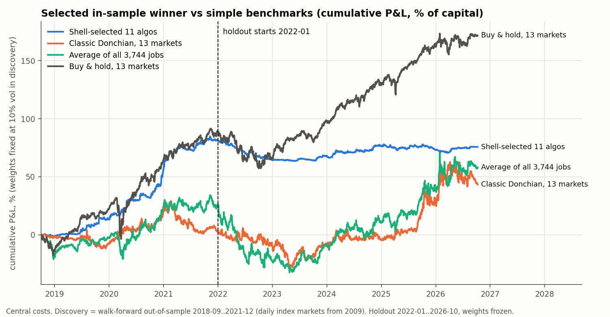
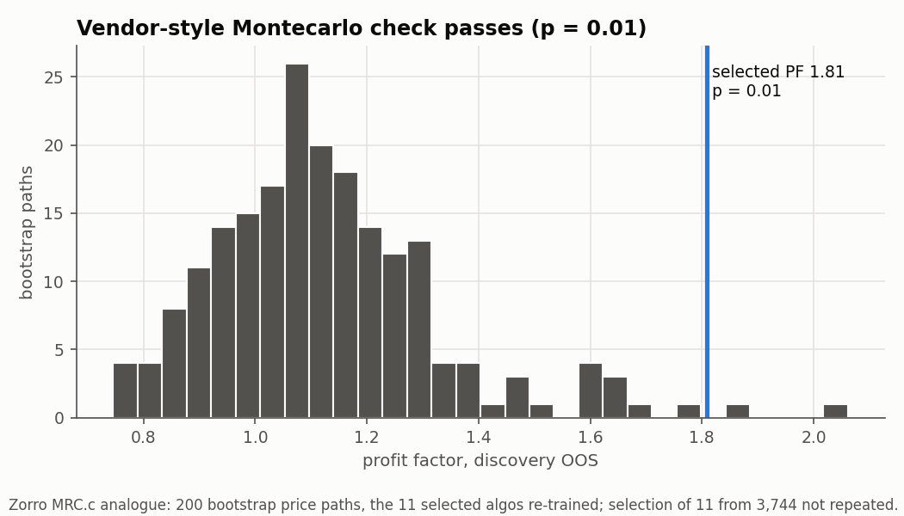

<!-- GENERATED FILE. EDIT THE CANONICAL KNOWLEDGE RECORD. -->

# RangerZ (Pardo Ranger on Zorro) range-breakout strategy generator: public-rule rebuild and Evaluation-Shell selection-bias audit

!!! warning "Research-only"
    This page summarizes saved research evidence. It does not authorize LIVE, allocation, or deployment.

## TL;DR

> **Verdict:** The public Ranger architecture (3,744 job-market cells) plus a mechanical Evaluation Shell selected 11 algos with discovery Sharpe 2.50; on the locked 2022-2026 holdout they lost money (Sharpe -0.22, 19th percentile of random 11-job picks, below classic Donchian 0.32, generator average 0.28 and buy-and-hold 0.95). The same pipeline on 30 bootstrapped random-price worlds gives discovery Sharpe 1.8-4.4 (p 0.90); the shell's own Montecarlo check still reports p 0.01. RangerZ's 35-350% 'annual return' is profit / (normalized drawdown + margin) on 1-lot CFDs.

> **Status:** `diagnostic`

> **Disposition:** `rejected`

> **Replication:** `not_reproducible`

## Research question

Does a Ranger-structured range-breakout strategy generator (public Ranger variable structure, public proxies for the proprietary TI trend indicators) plus the Zorro Evaluation Shell selection process (walk-forward summary, PF/R2 prefilter, 3x3 WFO cluster analysis, annual-return ranking, correlation pruning to 11 algos) deliver out-of-sample risk-adjusted returns on the RangerZ basic-portfolio markets (S&P500, DJI, DAX, gold, bitcoin; plus NQ) at 60m/4h/daily bars after costs on a locked 2022-2026 holdout, better than random selection from the same generator and better than a classic Donchian breakout?

## Exact setup

| Field | Value |
| --- | --- |
| Signal family | range_breakout_strategy_generator_and_walk_forward_selection |
| Universe | ["ES/NQ/GC continuous futures H1/H4 2016-2026", "BTC spot H1/H4/D1 2017-2026", "SPY, DIA, GLD (Norgate total return) and $DAX daily 1999-2026"] |
| Decision | Close of bar t-1 (resting stop/limit orders for bar t) |
| Fill | Inside bar t at the order level, or Open_t on a gap |
| Primary cost layer | central_research |
| Last reviewed | 2026-10-12T21:12:28+00:00 |

## Timing and overnight attribution

```text
information available: Close of bar t-1 (resting stop/limit orders for bar t)
primary executable fill: Inside bar t at the order level, or Open_t on a gap
```

If final `Close_T` data formed the signal, a hypothetical `Close_T` entry is diagnostic only unless a separate pre-close protocol was modeled. Comparing that diagnostic with `Open_(T+1)` and applying the compounded return identity shows whether the apparent edge occurred in the overnight gap. Missing attribution numbers mean **not tested**, not zero.

| Attribution field | Value |
| --- | --- |
| Status | not_applicable |
| Diagnostic Path | n/a |
| Executable Path | n/a |
| Method | Resting stop/limit orders; no Close_T fills |
| Headline Result | No close-to-open boundary to attribute. |
| Metrics | {} |
| Unavailable Reason | not applicable by construction |
| Artifact | N/A |

## Primary metrics

| Metric | Value |
| --- | ---: |
| Period | holdout 2022-01-01..2026-10-09 (discovery WFO OOS 2018-10..2021-12 for the selected algos) |
| Universe | 13 markets (see universes) |
| Cost Layer | central_research |
| Cagr | -1.15% |
| Annualized Volatility | 5.23% |
| Sharpe | -0.220 |
| Maximum Drawdown | -18.42% |
| Turnover | 1-lot round trips; selected algos about 2,060 trades in the holdout |

## Four separate verdicts

| Question | Conclusion |
| --- | --- |
| Source Replication | not_reproducible: Ranger code, RZ jobs and portfolios are paid/NDA; public variable structure rebuilt with proxies for proprietary TI indicators. |
| Predictive Value | Weak within-market: rank IC of discovery vs holdout Sharpe 0.114 (t 2.84, p 0.007, 13 markets); top-1% jobs median holdout Sharpe 0.19. Cross-market ranking reversed (BTC best -> worst, gold worst -> best). |
| Economic Value | None: holdout Sharpe paper 0.38 / central -0.22 / conservative -0.67. |
| Promotion | Fails 6 of 7 frozen conditions (only rank IC passes). Diagnostic; do not buy or implement. |

## Key findings

| Feature | Role | Direction | Status | Effect | Action |
| --- | --- | --- | --- | --- | --- |
| Evaluation Shell selection (WFO summary, PF/R2, 3x3 cluster, AR rank, correlation prune) | portfolio_construction | negative | rejected | holdout Sharpe -0.22 vs random median 0.16 | never trust a selected-portfolio backtest or its MRC p-value; demand a frozen cut-off and later data |
| Breakout stop entry vs limit (fade) entry | signal | positive for stop | diagnostic | median holdout Sharpe 0.12 vs -0.17 | consistent with existing trend work; nothing new |
| Within-market walk-forward rank | validation | positive | diagnostic | rank IC 0.114 | forward hypothesis at most: one with-trend breakout per market, daily |
| Zorro 'Annual return' and Sharpe definitions | diagnostic | inflating | documented | RangerLite SPX500: AR 75% vs ~7.6%/yr on notional | translate vendor AR to return on notional before comparing |

## Visual evidence






## Limitations

- Ranger rules (about 3000 lines of EasyLanguage) and the RangerZ jobs and portfolios are not public. This rebuilds the public architecture; it does not replicate RangerZ trades.
- Intrabar path heuristic on H1/H4/D1 bars instead of M1/tick fills.
- No DJI/DAX intraday; CFD spreads and financing approximated in bps.
- Brute-force PRR training instead of Zorro Ascent with parameter-chart smoothing.
- Intraday discovery is short: walk-forward OOS covers about 2018-09..2021-12.
- The real shell lets the user drop algos with unconvincing equity curves by eye; that discretionary step is replaced by the mechanical rank/correlation rule.

## Next gates

- None for RangerZ itself unless job files are obtained; then: frozen cut-off audit vs random picks.
- Forward-only hypothesis: one with-trend breakout stop per market on daily bars (overlaps existing trend sleeves).

## Sources

- `https://zorro-project.com/rangerz.php`
- `https://zorro-project.com/manual/en/rangerz.htm`
- `https://zorro-project.com/manual/en/shell.htm`
- `https://zorro-project.com/manual/en/performance.htm`
- `https://financial-hacker.com/implementing-robert-pardos-ranger-system/`
- `https://financial-hacker.com/coding-the-largest-strategy-ever/`
- `https://financial-hacker.com/build-better-strategies-part-6-evaluation/`
- `https://pardo.space`

## Canonical artifacts

| Artifact | Pakal path |
| --- | --- |
| Concise Report | `pakal-research/reports/rangerz_breakout_generator_study/REPORT.md` |
| Full Report | `pakal-research/reports/rangerz_breakout_generator_study/REPORT_FULL.md` |
| Notebook | `pakal-research/rangerz_breakout_generator_study.ipynb` |
| Frozen Specification | `pakal-research/reports/rangerz_breakout_generator_study/research_spec_frozen.json` |
| Manifest | `pakal-research/reports/rangerz_breakout_generator_study/run_manifest.json` |
| Source Code | `pakal-research/rangerz_breakout_generator/` |
| Zorro Script | `pakal-research/rangerz_breakout_generator/zorro/RangerLite.c` |
| Tables | `pakal-research/reports/rangerz_breakout_generator_study/tables/` |
| Charts | `pakal-research/reports/rangerz_breakout_generator_study/charts/` |
| Research State | `pakal-research/reports/rangerz_breakout_generator_study/research_state.json` |
| Hypothesis Registry | `pakal-research/reports/rangerz_breakout_generator_study/hypothesis_registry.json` |
| Experiment Ledger | `pakal-research/reports/rangerz_breakout_generator_study/experiment_ledger.jsonl` |
| Decision Log | `pakal-research/reports/rangerz_breakout_generator_study/decision_log.jsonl` |
| Source Rule Map | `pakal-research/reports/rangerz_breakout_generator_study/SOURCE_RULE_MAP.md` |
| Primary Source Code | `["pakal-research/rangerz_breakout_generator/rz_engine.py", "pakal-research/rangerz_breakout_generator/rz_pipeline.py", "pakal-research/rangerz_breakout_generator/rz_run.py", "pakal-research/rangerz_breakout_generator/zorro/RangerLite.c"]` |
| Primary Tables | `["pakal-research/reports/rangerz_breakout_generator_study/tables/selected_algos.csv", "pakal-research/reports/rangerz_breakout_generator_study/tables/all_jobs_discovery_holdout.csv", "pakal-research/reports/rangerz_breakout_generator_study/tables/null_worlds.csv", "pakal-research/reports/rangerz_breakout_generator_study/holdout_results.json"]` |
| Primary Charts | `["pakal-research/reports/rangerz_breakout_generator_study/charts/equity_selected_vs_benchmarks.png", "pakal-research/reports/rangerz_breakout_generator_study/charts/selection_bias_null_and_random.png", "pakal-research/reports/rangerz_breakout_generator_study/charts/rank_buckets_and_building_blocks.png", "pakal-research/reports/rangerz_breakout_generator_study/charts/mrc_vendor_style.png"]` |
