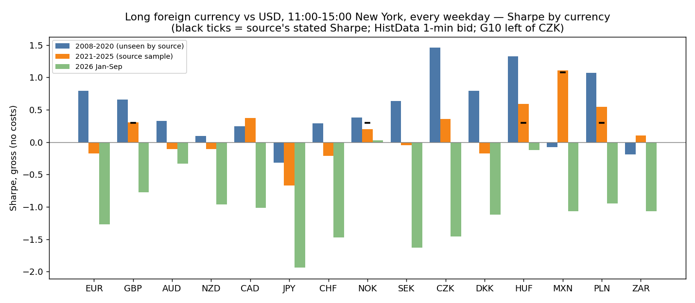
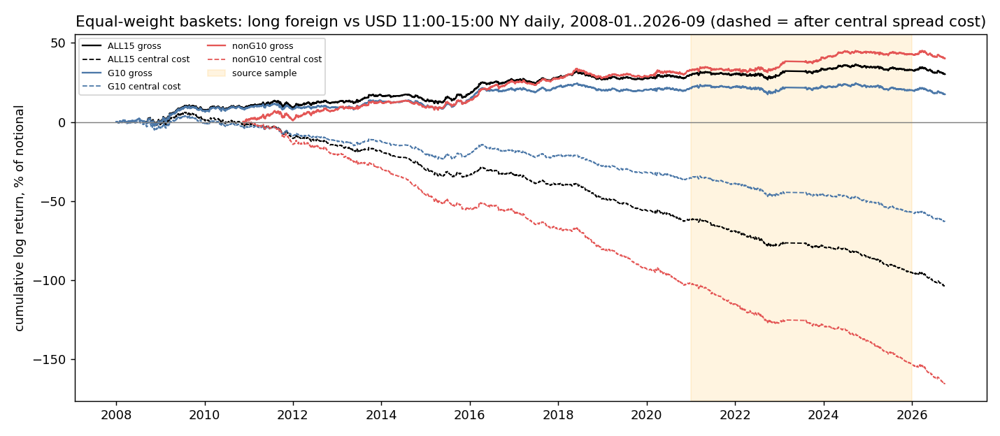

<!-- GENERATED FILE. EDIT THE CANONICAL KNOWLEDGE RECORD. -->

# Valuelytica 'The Four-Hour FX Trade' (long foreign currencies vs USD 11:00-15:00 New York) and 'YenStrike' (weekday JPY rule): 15 currencies, 2008-2026 1-minute data, London-fix mechanism, measured spreads

!!! warning "Research-only"
    This page summarizes saved research evidence. It does not authorize LIVE, allocation, or deployment.

## TL;DR

> **Verdict:** Both posts reproduce on 2021-2025 (GBP 0.30, MXN 1.11 vs 1.08, JPY -0.67; YenStrike Sharpe 1.30 vs 1.23). The US-hours drift against the dollar is real but tiny: 15-currency basket +0.93 bp/day in 2008-2020 (t 2.3), +0.26 bp in 2021-2025, -1.36 bp in 2026; central and measured costs exceed it in every period after 2020. YenStrike earns zero in 2008-2020 (Sharpe 0.01) and 2026; walk-forward signs earn nothing. Wednesday effect rejected. Mechanism: dollar bought into the London 4pm WM/R fix (11:00 NY) and released after it (pre-fix hour t -2.1). Rejected; diagnostic only.

> **Status:** `diagnostic`

> **Disposition:** `rejected`

> **Replication:** `directionally_replicated`

## Research question

Does long-foreign/short-USD held only 11:00-15:00 New York earn a premium that reproduces the source's 2021-2025 result, exists in unseen 2008-2020 and 2026, and survives spreads; does the YenStrike weekday JPY rule survive the same tests?

## Exact setup

| Field | Value |
| --- | --- |
| Signal family | calendar_intraday_fx_time_of_day |
| Universe | ["15 USD pairs: EUR GBP JPY CHF AUD NZD CAD NOK SEK (G10) + CZK DKK HUF MXN PLN ZAR, HistData 1-minute bid 2008/2010-2026", "ILS, KRW via Yahoo hourly 2024-2026 (diagnostic)", "EURJPY, AUDJPY (YenStrike vehicles)"] |
| Decision | calendar rule known in advance (clock time and weekday) |
| Fill | entry first trade at/after 11:00:00 NY, exit last trade before 15:00:00 NY, same day |
| Primary cost layer | central_research |
| Last reviewed | 2026-10-16T17:05:00+03:00 |

## Timing and overnight attribution

```text
information available: calendar rule known in advance (clock time and weekday)
primary executable fill: entry first trade at/after 11:00:00 NY, exit last trade before 15:00:00 NY, same day
```

If final `Close_T` data formed the signal, a hypothetical `Close_T` entry is diagnostic only unless a separate pre-close protocol was modeled. Comparing that diagnostic with `Open_(T+1)` and applying the compounded return identity shows whether the apparent edge occurred in the overnight gap. Missing attribution numbers mean **not tested**, not zero.

| Attribution field | Value |
| --- | --- |
| Status | not_applicable |
| Diagnostic Path | n/a (no close-derived signal) |
| Executable Path | 11:00 to 15:00 NY intraday window |
| Method | hour-of-day decomposition and DST-mismatch natural experiment replace close/open attribution |
| Headline Result | drift sits in the hours after the London 4pm fix; the hour before the fix has the opposite sign |
| Metrics | {"post_fix_hour_bps": 0.33, "post_fix_hour_t": 1.8, "pre_fix_hour_bps": -0.49, "pre_fix_hour_t": -2.06} |
| Unavailable Reason | calendar rule |
| Artifact | pakal-research/reports/valuelytica_fx_us_hours_study/tables/t10_post_fix_tests.csv |

## Primary metrics

| Metric | Value |
| --- | ---: |
| Period | 2008-01-02 to 2026-09-30 |
| Universe | ALL15 equal-weight basket, long foreign vs USD 11-15 NY |
| Cost Layer | central_research (basket mean 2.9 bp round trip) |
| Cagr | -5.58% |
| Annualized Volatility | 3.71% |
| Sharpe | -1.550 |
| Maximum Drawdown | -110.00% |
| Turnover | 25200.00% |

## Four separate verdicts

| Question | Conclusion |
| --- | --- |
| Source Replication | directionally replicated for both posts; YenStrike level 3.1% vs 4.27% claimed with the same Sharpe |
| Predictive Value | Four-Hour drift significant gross in 2008-2020 (7 currency cells BH q<0.10), fading since 2021, negative 2026; YenStrike none out of sample; Wednesday none |
| Economic Value | none: edge 0.5-2.5 bp/window vs measured round trips 0.2-4.4 bp + commission; every pair negative after 2020 at measured cost |
| Promotion | none; no shadow line; execution-timing note only (avoid buying USD in the hour before the London 4pm fix) |

## Key findings

| Feature | Role | Direction | Status | Effect | Action |
| --- | --- | --- | --- | --- | --- |
| Long foreign vs USD 11:00-15:00 NY (Four-Hour) | signal | positive (foreign up) | rejected | basket +0.93 / +0.26 / -1.36 bp per day (2008-20 / 2021-25 / 2026); per currency 0.5-2.6 bp in 2008-20 | do not trade; cost exceeds edge |
| Jiang window 10:00-16:00 NY | signal | positive | rejected | weaker than 11-15 (basket Sharpe 0.46 vs 0.61 gross 2008-20) | drop |
| Wednesday effect | filter | positive | rejected | Wed-minus-rest +1.0 bp (NW t 0.73) in 2008-20; -7.1 bp in 2026 | drop |
| YenStrike: short JPY Mon/Tue, long JPY Fri, 11-15 NY | signal | as source | rejected | 2021-25 Sharpe 1.30 gross; 2008-20 0.01; 2026 -0.11; walk-forward 0.06/-0.01 | drop |
| London 4pm fix dollar bid (pre-fix hour USD up, post-fix USD down) | diagnostic | foreign down before fix, up after | diagnostic | -0.49 bp (t -2.06) / +0.33 bp (t 1.80) per hour; DST-mismatch contrast -1.0 vs +0.4 bp (p 0.15) | execution note: avoid buying USD in the hour before the 4pm London fix |
| Vendor clock audit via NFP spike | diagnostic | n/a | note | HistData stamps are NY local time with DST (vendor docs say EST without DST) | reuse fxh_histdata.py loader; always audit intraday vendor clocks with a scheduled-release spike |

## Visual evidence






## Limitations

- HistData is bid-only and has hour gaps (Feb-Jul 2023, AUDJPY 2012); measured spreads are a 3-month Dukascopy sample
- ILS and KRW (two of the source's best currencies) only from 2024 via Yahoo hourly
- Source vendor, timestamps and G10 list unknown; replication is directional
- Fix-mechanism tests are post-hoc and only moderately significant

## Next gates

- none for trading; if FX conversion timing ever matters for the book, measure the fix-hour dollar bid on the user's actual conversion venue

## Sources

- `https://valuelytica.substack.com/p/the-four-hour-fx-trade`
- `https://valuelytica.substack.com/p/yenstrike-weekly-fx-seasonality`
- `Jiang (2019) SSRN 2613592`
- `Krohn, Mueller, Whelan (2024) Journal of Finance`
- `HistData.com 1-minute bid; Dukascopy bid/ask sample; Yahoo Finance hourly`

## Canonical artifacts

| Artifact | Pakal path |
| --- | --- |
| Concise Report | `pakal-research/reports/valuelytica_fx_us_hours_study/REPORT.md` |
| Full Report | `pakal-research/reports/valuelytica_fx_us_hours_study/REPORT_FULL.md` |
| Notebook | `pakal-research/reports/valuelytica_fx_us_hours_study/valuelytica_fx_us_hours_study.ipynb` |
| Frozen Specification | `pakal-research/reports/valuelytica_fx_us_hours_study/research_spec_frozen.json` |
| Manifest | `pakal-research/reports/valuelytica_fx_us_hours_study/run_manifest.json` |
| Primary Source Code | `["pakal-research/valuelytica_fx_us_hours/fxh_lib.py", "pakal-research/valuelytica_fx_us_hours/fxh_run.py", "pakal-research/valuelytica_fx_us_hours/fxh_histdata.py", "pakal-research/valuelytica_fx_us_hours/fxh_supplement.py", "pakal-research/valuelytica_fx_us_hours/fxh_spread_probe.py"]` |
| Primary Tables | `["pakal-research/reports/valuelytica_fx_us_hours_study/tables/t01_per_currency.csv", "pakal-research/reports/valuelytica_fx_us_hours_study/tables/t02_baskets.csv", "pakal-research/reports/valuelytica_fx_us_hours_study/tables/t06_yenstrike.csv", "pakal-research/reports/valuelytica_fx_us_hours_study/tables/t12_post_measured_cost_layer.csv"]` |
| Primary Charts | `["pakal-research/reports/valuelytica_fx_us_hours_study/charts/c01_sharpe_by_currency_by_period.png", "pakal-research/reports/valuelytica_fx_us_hours_study/charts/c02_basket_cumulative.png", "pakal-research/reports/valuelytica_fx_us_hours_study/charts/c03_hour_of_day_profile.png", "pakal-research/reports/valuelytica_fx_us_hours_study/charts/c04_yenstrike.png"]` |
| Research State | `pakal-research/reports/valuelytica_fx_us_hours_study/research_state.json` |
| Hypothesis Registry | `pakal-research/reports/valuelytica_fx_us_hours_study/hypothesis_registry.json` |
| Experiment Ledger | `pakal-research/reports/valuelytica_fx_us_hours_study/experiment_ledger.jsonl` |
| Decision Log | `pakal-research/reports/valuelytica_fx_us_hours_study/decision_log.jsonl` |
| Source Rule Map | `pakal-research/reports/valuelytica_fx_us_hours_study/SOURCE_RULE_MAP.md` |
